# 阶段 6.2 九大模块截图

> 采集时间：2026-11-27 10:49:50　采集方式：tools/capture_screenshots.py（Playwright + Chromium 无头）
> 数据基线：26 个库位（24 货架 + 2 月台）、8 台 AGV、16 条物料、6 张入库单、5 张出库单。

| 截图 | 页面 | 对应模块/看点 |
|---|---|---|
| 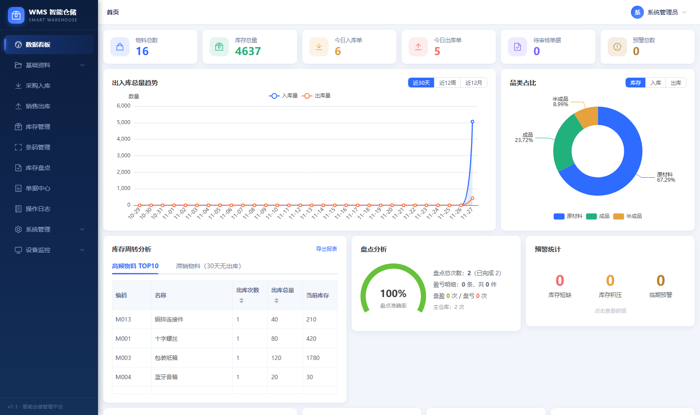 | `/dashboard` | 模块9 统计总览 |
|  | `/dashboard` | 模块9 AGV 统计与导出 |
| 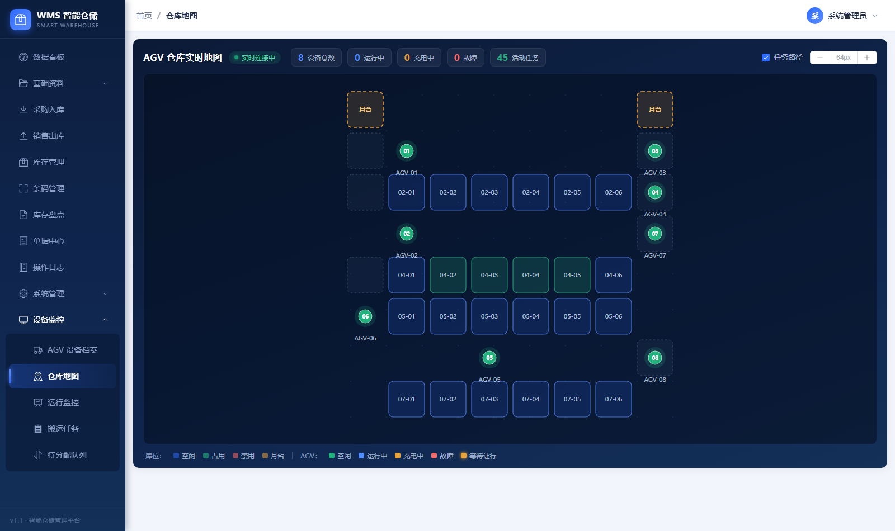 | `/agv/map` | 模块2/6 地图与库位（26 个库位 + 8 台 AGV） |
| 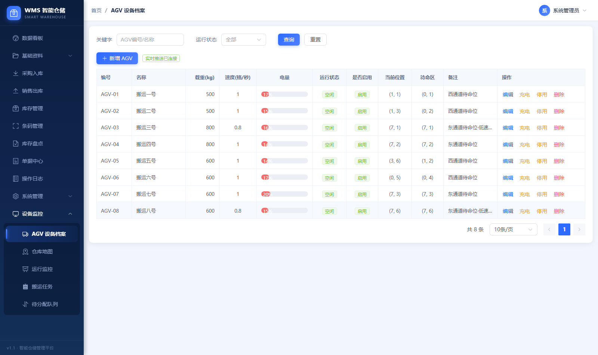 | `/agv/device` | 模块3 设备档案 |
| 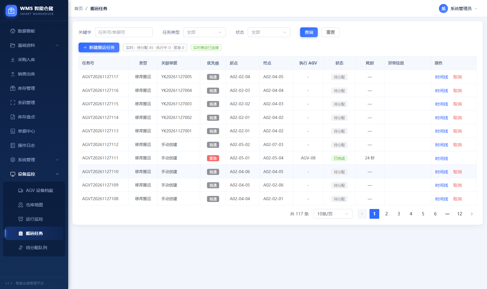 | `/agv/task` | 模块4 搬运任务管理 |
| 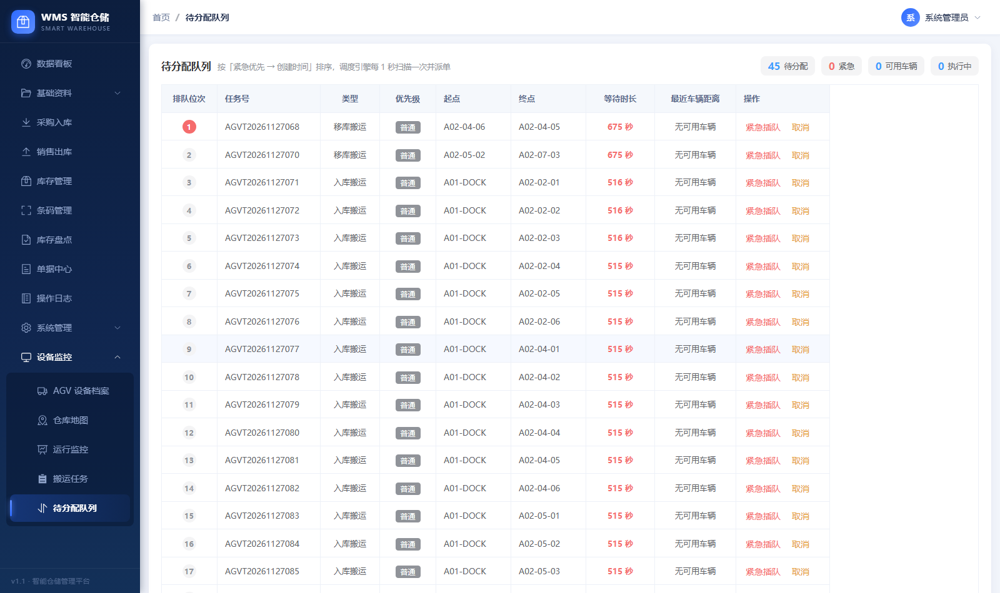 | `/agv/queue` | 模块5 调度分配 |
| 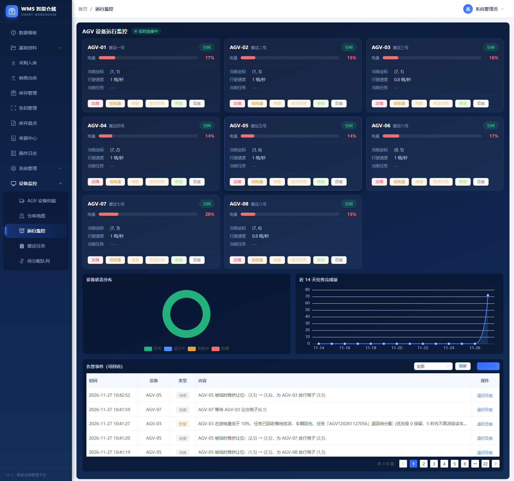 | `/agv/monitor` | 模块7/9 监控大屏（8 台设备卡 + 状态分布环形图 + 完成量折线图） |
|  | `/agv/monitor` | 模块6/8 告警可回看（告警/故障/冲突三类，可筛选分页） |
| 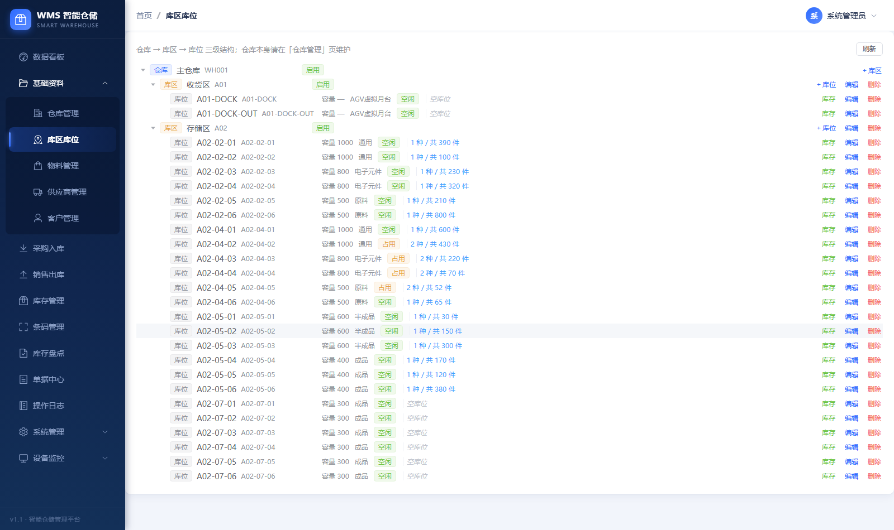 | `/base/location` | 模块2 库区库位 |
| 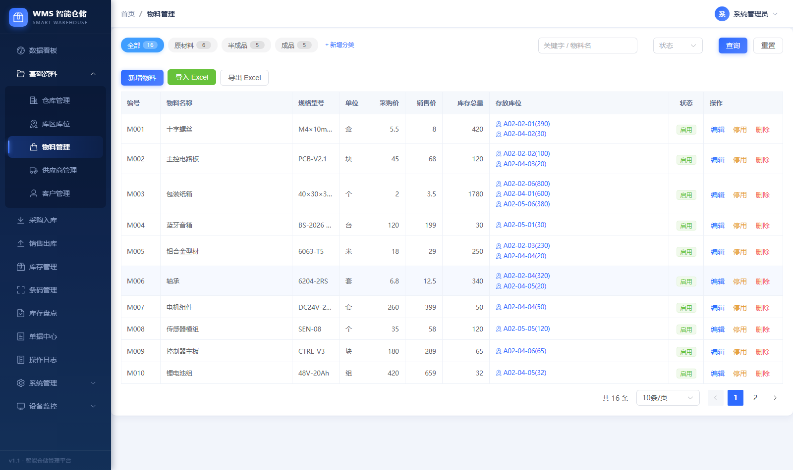 | `/base/material` | 模块2 物料档案 |
| 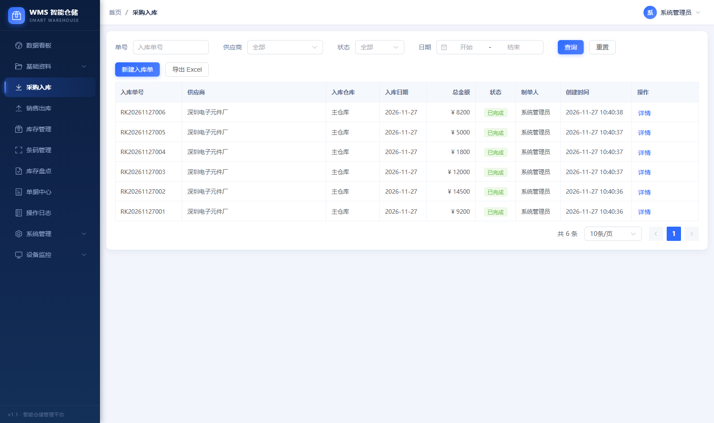 | `/inbound` | 模块 采购入库 |
| 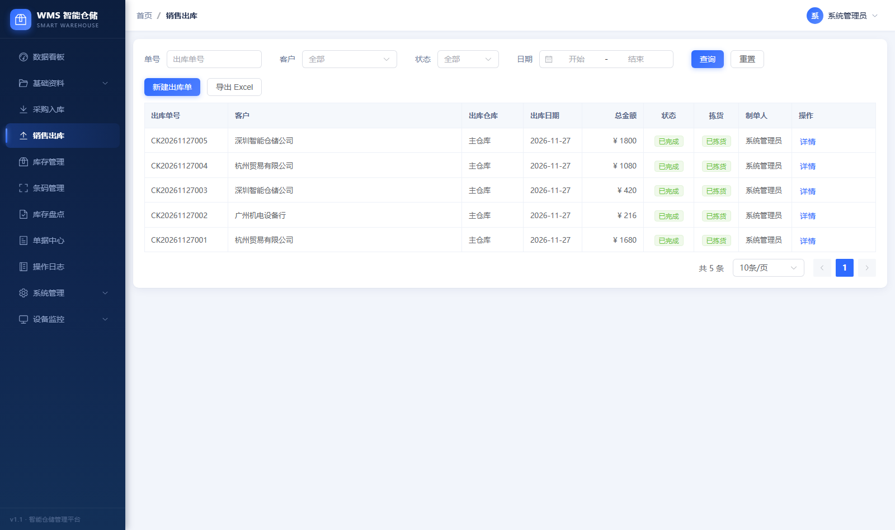 | `/outbound` | 模块 销售出库 |
| 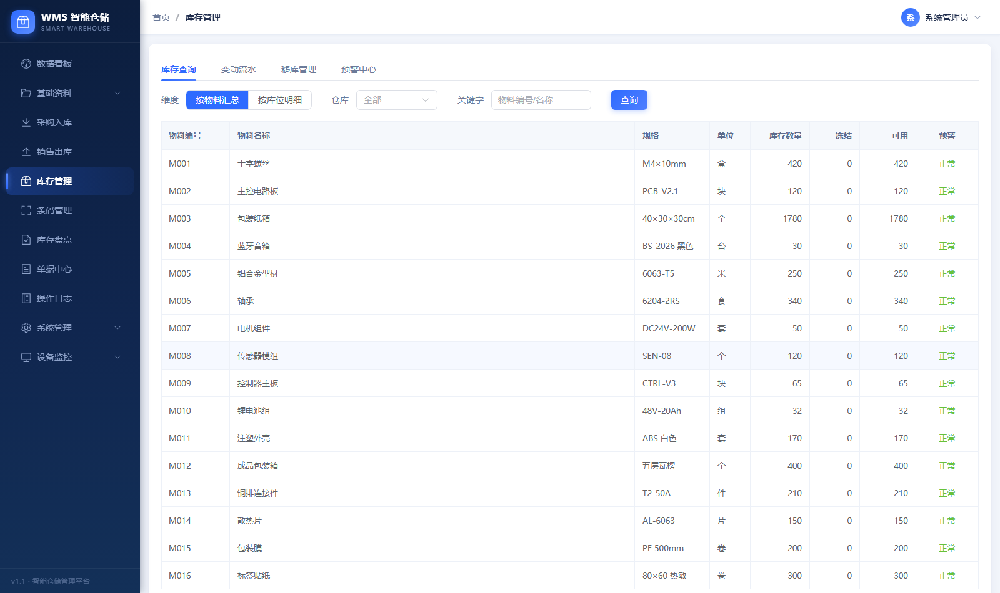 | `/inventory` | 模块 库存管理 |
| 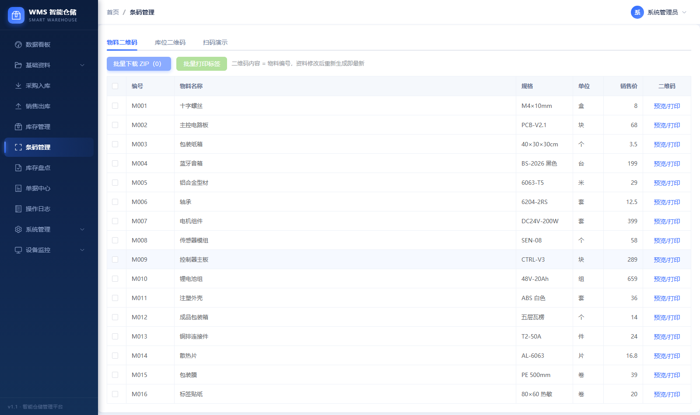 | `/qrcode` | 模块 条码管理 |
| 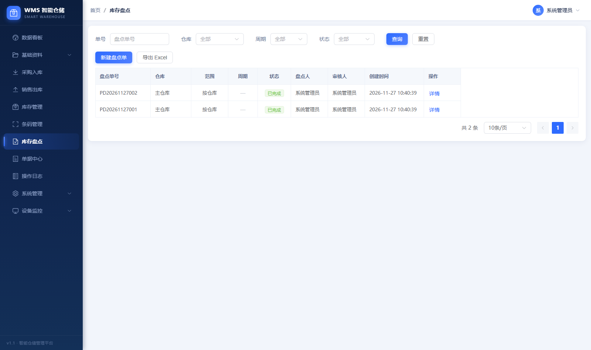 | `/check` | 模块 库存盘点 |
| 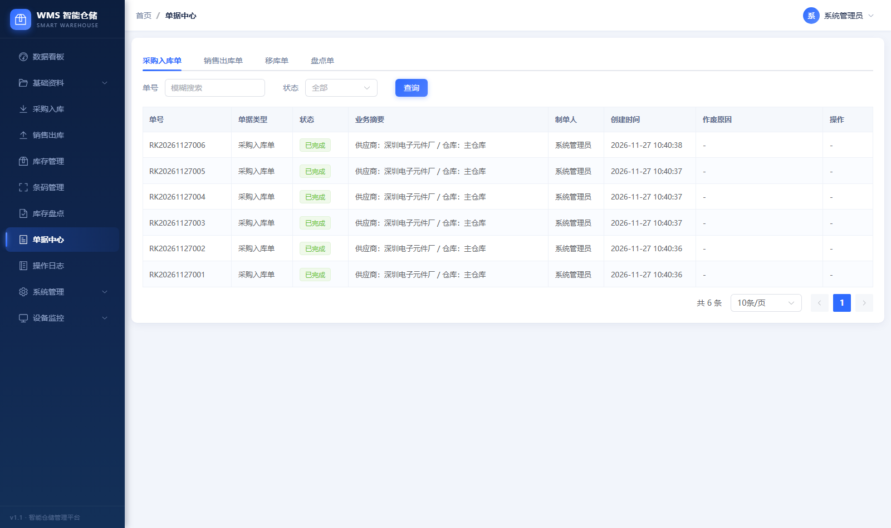 | `/doc` | 模块 单据中心 |
| 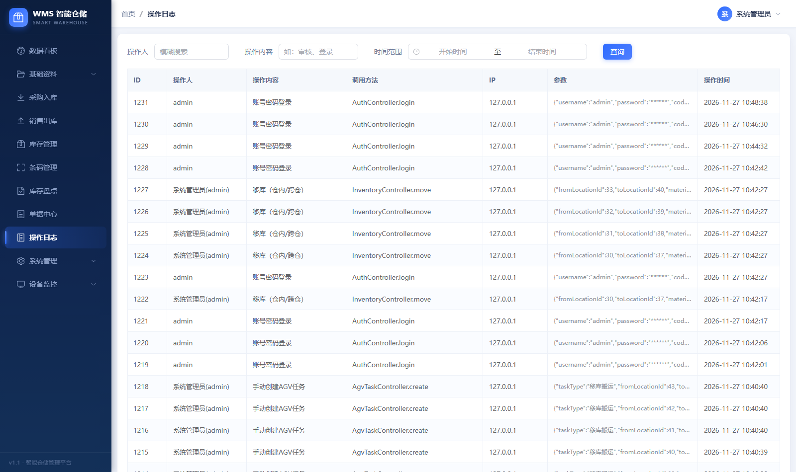 | `/log` | 模块 操作日志 |
| 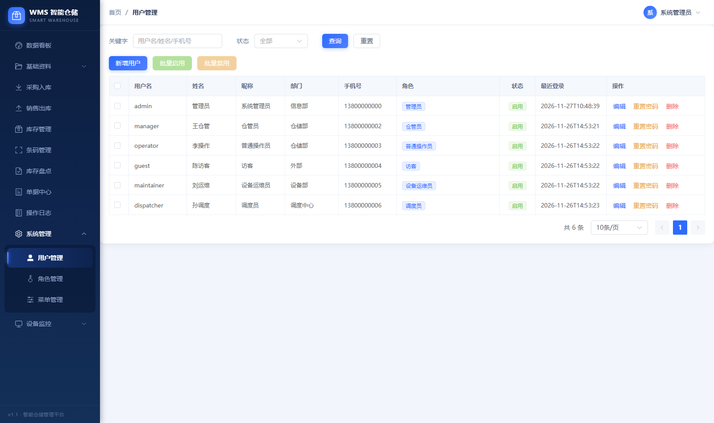 | `/system/user` | 模块1 权限管理 |
