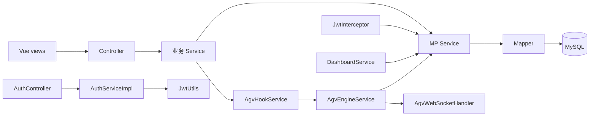

# WMS / 多 AGV 调度系统 架构评审与改造建议

> 评审对象：`D:\Desktop\wms-main`（Spring Boot 3.3.7 + Java 21 + MyBatis-Plus 3.5.9 + MySQL 8 + Vue 3）
> 评审时间：2026-11-27
> 评审方式：后端 178 个 Java 文件（20 个 Controller）、26 个 Vue SFC 通读 + 启动实测（8080 连 `wms`）+ 隔离库 `wms_racetest` 并发实验 + 与上一版评审（`D:\Desktop\deepseek\wms-架构评审与改造建议.md`）逐条对账
> 版本：**v3 终版**（2026-11-27）。在 v2 基础上：新增 §2.4 分层架构评估；§6 重排为 20 人日终版计划（AGV 拆分只保留 Step 1–3）；新增 §9 终版审核。v2 的结论与证据不变。
> 约束基线：不改表结构、不引 Spring Security、不改 API 路径、不引 Redis/MQ、单机可运行

---

## 0. 总体判断

系统功能闭环完整、分层骨架清楚、AGV 调度演示性强，作为毕设"能跑、能讲、有数据"。但一致性与安全两道防线都建立在"先查后写"上：单号 `count+1`、库存 read-modify-write、审核无状态 CAS、业务接口零鉴权。平时演示不会暴露，一旦并发或换人操作就是 500 与错账。**结论：毕设可过（良），生产不可上线；答辩前至少修掉 P0-1/P0-2 并能现场跑并发用例。**

| 维度 | 毕设视角 | 生产视角 | 依据 |
|---|---:|---:|---|
| 分层与模块化 | 8 | 6 | Controller/Service/Mapper 清晰；库存写入分散在 4 个 Service |
| 领域模型 | 7 | 5 | 25 表、唯一键齐全；`frozen_qty` 有字段无流程 |
| 数据一致性 | 5 | 2 | 先查后写、RMW、无 CAS、无补偿 |
| 并发控制 | 4 | 2 | 单号 `count+1`；审核/复核可穿透（实测） |
| 安全鉴权 | 4 | 1 | 仅 AGV 有 `@RequireRole`；GUEST 可增删主数据（实测） |
| AGV 调度 | 8 | 5 | 1Hz 状态机、双格预留、等待图破环完整；0 事务、内存态不可恢复 |
| 可测试性 | 1 | 1 | `src/test` 不存在，0 自动化测试 |
| 可观测/运维 | 3 | 2 | 有业务日志，无 traceId；HTTP 恒 200 |
| 前端工程 | 7 | 5 | 结构完整、动态路由；无 lint/test |
| 文档与演示 | 8 | 6 | `docs/evidence` 7 个阶段证据齐全 |
| **加权总分** | **6.2** | **3.1** | 毕设"良"，生产"不可上线" |

### 0.1 评分口径校准

上一版评审给"毕设 85+"，本报告给 6.2/10，两者不矛盾，是两把尺子：毕设看完成度、文档、演示、工作量；工程看一致性、并发、安全、测试，权重几乎相反。

| 口径 | 分数 | 主要依据 |
|---|---:|---|
| 毕设答辩 | 85/100（良） | 25 表闭环、7 份阶段证据、AGV 可视化、论文素材足 |
| 工程健康度 | 6.2/10 | 测试 1、鉴权 1、并发 2、一致性 2 |
| 折算百分制 | 62/100 | 与 85 的差 = 工程项权重差，不是事实分歧 |

答辩表述建议用"功能完成度 85，工程健康度 62"。单说"架构 85 分"，评委一问并发就会掉分；反过来只说"62 分"又抹掉了工作量。

### 0.2 重梳理后的四层优先序

20+ 条问题按"停血 → 止错 → 解耦 → 工程化"压成四层，这也是 §6 排期的排序依据：

| 层 | 内容 | 判据 | 对应条目 |
|---|---|---|---|
| 红线 | 鉴权、密钥、单号 | 能被外部直接利用，或演示当场翻车 | P0-1/2/6 |
| 正确性 | 库存写路径、状态 CAS、预占 | 并发下账实不符 | P0-3/4/5/7、P1-5/6 |
| 结构 | 事务边界、AGV 六类、前端路由 | 改一处要动三处 | X1、§2.2、P1-1..4 |
| 工程化 | 测试、CI、DTO、HTTP 状态 | 回归靠手点，问题靠猜 | §5、P2 |

---

## 1. 证据链与可信边界

### 1.1 实测证据

| 编号 | 实验 | 方法 | 结果 | 证据文件 |
|---|---|---|---|---|
| E1 | 越权 | `guest/123456` 登录后调业务接口 | 建仓库 `RV-TEST` → `code 200`；删除 → `code 200`；读库存流水 → `code 200`；仅 `/system/user/page` 返回 `code 403` | `.tmp/livecheck.json` |
| E2 | 单号并发 | 24 线程并发 `POST /inbound/create`（隔离库 8081） | **成功 3，失败 21**，失败全部为 `500\|系统异常，请联系管理员`（`uk_order_no` 撞号，无重试） | `.tmp/race.json` |
| E3 | 入库审核并发 | 20 线程并发 `PUT /inbound/audit` 同一单 | 成功 1；10 条"单据当前状态不可审核"；**9 条撞 `uk_wlm` 回滚**；终态库存 10（未被重复加） | `.tmp/race_audit.json` |
| E4 | 后端构建 | `mvn -q -DskipTests package`（JDK 21） | exit 0 | 本地 |
| E5 | 前端构建 | `npm --prefix wms-web run build` | 沙箱内 `Error: spawn EPERM`（vite 调 `exec`），**环境限制，未验证** | — |

E3 的解读很关键：**状态闸门确实被 9 个线程穿透了**，只是首次入库要 `INSERT`，被 `uk_wlm` 唯一键偶然挡住并回滚；若该库位已有库存行，走的是 `updateById` 的 RMW 分支，就会直接叠加。这条"唯一键兜底"不能当成幂等设计——它只在"新库存行"这一种情况下生效。

### 1.2 明确未验证的项

- **性能**：未做 24 车满载压测；tick 内全表查询的实际耗时未测（代码结构上偏高，见 P1-11）。
- **重启恢复**：未做 kill -9 后重启的实测；"任务卡死"由内存态结构推断（`pathQueue`/`waitTicks` 均为进程内 Map），需按 §4.3 的用例补测。
- **盘点并发覆盖**：E3 只覆盖入库审核；盘点的 `setQuantity` 覆盖由代码路径推断，未构造"盘点审核与出库复核同时发生"的实测。
- **前端**：构建未能在沙箱内完成，前端只做了静态结构核对。

---

## 2. 模块 → 职责 → 依赖方向

### 2.1 分层与模块

| 层 | 模块 | 职责 | 依赖方向 | 代表文件 |
|---|---|---|---|---|
| 接入层 | `controller`（20 个） | HTTP 入参、`@Validated`、返回 `Result` | → 业务 Service / MP Service | `InboundController.java`、`AgvTaskController.java` |
| 切面 | `aspect` + `annotation` | `@RequireRole` 角色校验，越权抛 `BizException(403)` | 读 `UserContext` | `RequireRoleAspect.java` |
| 认证 | `interceptor` + `service/impl/AuthServiceImpl` | JWT 解析、用户/角色装载、验证码、登录注册 | → `SysUserService`、`JwtUtils` | `JwtInterceptor.java:33-53` |
| 业务域 | `service`（8 个业务类） | 入库/出库/盘点/库存/单据/看板 | → MP Service、`AgvHookService` | `InboundService.java`、`OutboundService.java`、`CheckService.java`、`InventoryService.java` |
| 调度域 | `service/AgvEngineService` | 1Hz 状态机、路径、预留、等待图、充电 | → `WmsAgv*Service`、`WmsLocationService`、`AgvWebSocketHandler` | `AgvEngineService.java`（1850 行） |
| 桥接 | `service/AgvHookService` | 业务事件 → AGV 任务 | → `AgvEngineService`、`WmsLocationService`、`WmsInboundOrderService` | `AgvHookService.java:39-99` |
| 数据访问 | `mapper` + `service/Wms*ServiceImpl` | MyBatis-Plus CRUD | → MySQL | `MybatisPlusConfig.java:15-20` |
| 实时通道 | `websocket` | AGV/任务/告警广播 | ← 调度域 | `AgvWebSocketHandler.java:47-72` |
| 前端 | `wms-web/src` | 24 个视图、动态路由、Pinia | → `/api` | `router/index.js`、`api/*.js` |

依赖图（编译期）：



### 2.2 循环依赖与越界调用

**类级无环**（构造器注入图已逐类核对），但**域级有环**：`InboundService:283` → `AgvHookService:39` → `WmsInboundOrderService`，而 `AgvHookService:26-28` 又直接依赖 `WmsInboundOrder/WmsOutboundOrder/WmsOutboundItem` 实体，即 inbound/outbound ↔ agv 双向依赖。此外有 4 处结构性越界：

| 编号 | 类型 | 位置 | 说明 | 后果 |
|---|---|---|---|---|
| X1 | 事务穿透 | `InboundService.java:283` → `AgvHookService.onShelf:39-46` → `AgvEngineService.createTask:1302-1330` | 业务事务内建 AGV 任务、写任务日志并 `pushTask` 广播 | 业务回滚后 WS 已把"任务已建"推给前端；`@Transactional` 管不到 socket 与内存 Map，前端与库不一致 |
| X2 | 写入口分散 | `InboundService.java:371-391`、`OutboundService.java:339-342`、`CheckService.java:263-282`、`InventoryService.java:195-221/341-356` | `wms_inventory` 有 4 个类、6 处写点，各自实现 RMW | 没有单一"库存记账"入口，任何一处漏改就破坏不变量；这是 §3 一致性问题的根因 |
| X3 | 鉴权三套实现 | 注解：`AgvDeviceController.java:192` 等 14 处；Service 手写：`InboundService.java:323-327`、`OutboundService.java:225-228`、`CheckService.java:241-244`；Controller 手写：`SysUserController.java:54-58` | 同一件事三种写法，覆盖不全 | 新增接口默认无鉴权（P0-1 的直接原因） |
| X4 | 接入层耦合持久化 | 18 处实体 `@RequestBody`：`BasWarehouseController.java:66/79`、`BasMaterialController.java:114/129/234/247`、`BasLocationController.java:179/201/226/249`、`BasCustomerController.java:76/89`、`BasSupplierController.java:74/87`、`AgvDeviceController.java:194/222`、`ProfileController.java:57`、`AgvTaskController.java:93` | API 契约 = 表结构 | 改表即改 API；客户端可直接赋值 `status`/`price`/`createTime`（P0-7） |

**判断**：真正要治理的是 X2（库存写入口）与 X1（事务边界）。X2 收敛后，P0-3/4/5 的补丁才有唯一落点；X1 决定了 AGV 与业务能否解耦。

### 2.3 功能模块设计评审（上一版评审补充，已逐项核实）

上一版按业务域逐个模块评了一遍，这块比 v1 细，本次全部按代码复核后并入：

| 模块 | 现状 | 设计问题（已核实） | 改法（不改表） | 级别 |
|---|---|---|---|---|
| 权限 RBAC | 登录发 JWT；拦截器每请求 3 次查询（`JwtInterceptor.java:39` + `AuthServiceImpl.listRoleCodes:172-179`） | token 24h 不可吊销；`sys_menu.perms` 有数据但 Java/前端 0 引用、`menu_type='F'` 0 条，按钮级权限为空；`@RequireRole` 只覆盖 AGV | 登出/改密加 `jti` 内存黑名单；按钮权限先做前端隐藏，后端仍以接口注解为准 | P0/P2 |
| 基础资料 | 8 个主数据 CRUD + Excel 导入导出 | 18 处实体直传，body 带 id 可改任意行；`location.status` 既是"禁用"又是"占用" | DTO 白名单 + 路径 id 优先；"一库位一物料"写进文档 | P0-7/P1-10 |
| 采购入库 | 建单→质检→上架→审核→记账 | `shelf:278-281` 只置 `shelfStatus=1`+库位占用，不记账；`audit:371-391` 才写库存，即**账先于物**；`qualityStatus=2` 的不合格品不能上架，`audit` 只处理合格明细，无退货/让步/报废，整单其余明细被排除 | 增加不合格处置（退货/让步/报废），仍写 `wms_inventory_log`；不改表可用备注+流水表达 | P1 |
| 销售出库 | 建单→审核→拣货→复核→扣减 | 审核只校验不冻结，`frozen_qty` 形同虚设；复核 `339-342` 条件扣减正确，但状态无 CAS；无波次/批量拣货 | 审核预占、复核同扣、状态 CAS；波次放到 W4 之后 | P0-4 |
| 库存 | 查询/流水/移库/冻结 | 4 个 Service、6 处写点；移库目标 RMW；冻结 RMW | 收敛为 `InventoryService.addStock/subStock/freeze` 三个原子方法 | P0/P1 |
| 盘点 | 按仓/区/分类圈库存→快照→实盘→审核 | `:280 setQuantity` 覆盖并发；`:263-266` 缺 `warehouseId`；差异流水 `:283-294` 确实写了，但 before/after 在并发下失真 | 增量 `quantity+diff` + 状态 CAS | P0-5 |
| 单据 | 作废/查询 | 入库/出库仅 status 0/2 可作废，`:119/:136` 联动 `onOrderInvalid`；MOVE 仅 0 是**显式设计**，不是 bug | 保持；补"作废需管理员"注解 | P1 |
| AGV | 1Hz 状态机 + BFS + 双格预留 + 破环 | 见 §2.2/§4.3；派单有 `LOAD_PENALTY_WEIGHT` 等权重，路径 BFS 无转向代价，策略只影响"派给谁"不影响"怎么走" | 先切 Publisher/Planner 两个面，再谈策略插件化 | P1 |
| 看板 | ECharts + 全表聚合 | `DashboardService.agvStats:59-120` 全表 list + 3 次 count；`AgvTaskController.stat:109` 整表 list | 时间窗 + 索引 + 60s 缓存 | P1-14 |
| 前端 | 26 个 SFC，最大 654 行 | 动态路由 `router/index.js:73/98-100` 只 add 不 remove，换角色菜单残留；`Placeholder` 静默 fallback:51 | logout 时 `removeRoute` 或整页 reload；占位页显式提示 | P2-9 |

### 2.4 分层架构评估

**结论：分层是完整的，属于"前后端分离的四层结构 / MVC 变体"；形式对，边界纪律松。**

| 层 | 目录 | 数量 | 职责 | 依赖方向 |
|---|---|---|---:|---|
| 表现层 | `controller/` | 20 | HTTP 协议转换、参数校验、`Result` 包装 | → Service |
| 业务层 | `service/`（interface + `impl`） | 60 | 业务规则、事务、跨表编排 | → Mapper / MP Service |
| 持久层 | `mapper/` | 25 | `BaseMapper` + Wrapper；`resources/mapper` 下 **0 个 XML** | → Entity |
| 模型层 | `entity/` 25、`dto/` 20、`vo/` 9 | 54 | PO / 入参 / 出参 | 被各层引用 |
| 横切 | `interceptor/`、`aspect/`、`common/`、`config/` | 14 | 鉴权、操作日志、统一返回、配置 | 无业务依赖 |
| 前端视图 | `wms-web/src/views/` | 24 | 真正的 View，经 `/api` 取 JSON | → HTTP |

严格说后端只有 M 和 C，V 在 Vue。答辩时讲"**前后端分离的 MVC 变体 / 四层架构**"，不要讲"Spring MVC 的 MVC"，否则"你的 View 在哪"无法回答。

**做对的（有证据）：**

1. `controller/` 下 `Mapper` 出现 **0 次**——没有跨层直连数据库。
2. `controller/` 下 `@Transactional` **0 处**，`service/` 下 **17 处**——事务边界基本在业务层。
3. 无反向依赖：没有 Service 调 Controller，也没有 Mapper 调 Service。
4. 横切独立：`JwtInterceptor` + `RequireRoleAspect` + `OperationLogAspect`，没有散进业务代码。
5. 模型层已分 Entity/DTO/VO（`InboundService.createOrder` 收 DTO、返回 VO 是标准写法）。

**越界的（按严重度）：**

| # | 越界 | 位置 | 问题 |
|---|---|---|---|
| 1 | Controller 里写业务规则 | `BasWarehouseController.java:66-98`、`:108` 起的 `checkCodeUnique` | 唯一性/删除前校验应在 `WmsWarehouseService`；Excel 导入等入口会绕过 |
| 2 | Controller 里做统计聚合 | `AgvTaskController.java:108-160` | 近 50 行"14 天完成量/类型占比/平均耗时"应在看板 Service |
| 3 | Controller 里拼查询条件 | `BasWarehouseController.java:42-52` | Controller 知道了表字段名，加字段就要改 Controller |
| 4 | Entity 当 API 契约 | 18 处 `@RequestBody`（`BasWarehouseController:66/79`、`BasMaterialController:114/129/234/247` 等） | 模型层泄漏到表现层：改表即改 API，且可批量赋值 `status`/`createTime` |
| 5 | 鉴权下沉到 Service | `InboundService.java:323-327`、`OutboundService.java:225-228`、`CheckService.java:241-244` | "谁能调"混进"做什么"，单测被迫构造 `UserContext` |
| 6 | 业务层依赖调度层并广播 | `InboundService.java:283` → `AgvHookService.onShelf:39-46` → `AgvEngineService.createTask` + `pushTask` | 业务事务里做了不可回滚的事（建任务、发 WS），回滚后前端已收到 |
| 7 | 异常抹平 HTTP 语义 | `GlobalExceptionHandler.java:21-45` | 全部返回 `Result`、HTTP 恒 200，网关与监控失效 |

**三项最小整改（已排进 §6，不新增依赖）：**

| 整改 | 做法 | 人日 | 周 |
|---|---|---:|---|
| 鉴权回 Controller | `@RequireRole` 覆盖 10 个业务 Controller 写接口，删 Service 内三处手写角色判断 | 0.5 | W1 |
| 实体不出 Controller | 18 处换 DTO（字段名保持不变，Jackson 默认忽略未知字段）；响应暂留实体，避免前端改 | 1 | W4 |
| Controller 瘦身 | `checkCodeUnique` 下沉 Service、`agvStat` 下沉看板 Service | 0.5（并入 W4 DTO） | W4 |

## 3. 问题清单（P0 / P1 / P2）

> 行号以当前工作区代码为准；标注"未验证"的条目未做运行时复现。
> 工作量口径：0.5d / 1d / 2d，按 1 人熟悉代码后估算，含自测不含联调。

### 3.1 P0（数据/安全红线，答辩前必须处理）

| 编号 | 问题 | 位置 | 后果 | 修法 | 工作量 |
|---|---|---|---|---|---|
| P0-1 | 业务接口零鉴权 | `InboundController.java:90/150`、`OutboundController.java:87/105/113/121`、`CheckController.java:78/101`、`InventoryController.java:61/90/104`、`DocController.java:43`、`Bas*Controller` 全部写接口 | 任何登录用户（含 GUEST）可建删仓库/物料、审核扣库存、冻结、作废（E1 实测） | 写接口加 `@RequireRole`，读接口要求登录；矩阵见附录 C | 1d |
| P0-2 | 单号 `count+1` | `InboundService.java:132-136`、`OutboundService.java:160-164`、`CheckService.java:129-133`、`InventoryService.java:283-287` | 并发撞 `uk_order_no`，24 并发仅 3 成功（E2） | `MAX(CAST(SUBSTRING)) +1`，捕获 `DuplicateKeyException` 重取重试（复用 `AgvEngineService.genTaskNo:1340-1358` 的写法） | 1d |
| P0-3 | 入库审核非幂等 | `InboundService.java:311-405`（状态读 320、库存 371-391、状态写 404-405） | 并发/重复提交重复加库存；E3 中 9 个线程已穿透状态闸门，仅被 `uk_wlm` 偶然挡住；已有库存行时直接叠加 | 末尾状态 CAS（`WHERE status=审核前`）+ 库存原子累加/upsert | 1d |
| P0-4 | 出库审核不预占、复核可双扣 | `OutboundService.java:213-272`（只校验不冻结）、`315-377`（扣减后无条件改状态） | 两单同批库存都能审核并拣货，后复核失败→账实不符；并发复核同一单扣两次 | 审核时 `frozen_qty += qty`（条件 `quantity-frozen>=qty`）；复核 `quantity-=qty AND frozen-=qty` + 状态 CAS；取消/驳回释放 | 2d |
| P0-5 | 盘点审核覆盖库存 | `CheckService.java:229-298`（`setQuantity` 280、状态写 296-297） | 盘点期间发生的出入库被快照值覆盖，直接错账 | 按 `diff_qty` 增量更新（`quantity = quantity + diff`），末尾状态 CAS | 1d |
| P0-6 | 密钥/口令明文 | `application.yml:14`（`password: 123456`）、`:33`（JWT secret 明文）、`AuthServiceImpl.java:71`（验证码进日志） | 拿到仓库即可伪造任意用户 JWT；日志泄露验证码 | 环境变量占位 + 启动非空校验；生产关闭验证码日志；改默认口令 | 0.5d |
| P0-7 | 实体直传 + body 主键 | `BasWarehouseController.java:79-86`、`BasMaterialController.java:246-247`、`BasLocationController.java:248-249`、`BasCustomerController.java:89`、`BasSupplierController.java:87`、`AgvDeviceController.java:222` | 客户端可改任意行（body 自带 id）、可写 `status`/`price`/`createTime`；无归属校验 | 路径 id 优先 + 白名单 DTO；过渡期至少服务端覆盖 id/审计字段、忽略非白名单字段 | 1d |

### 3.2 P1（正确性/可用性，2 周内处理）

| 编号 | 问题 | 位置 | 后果 | 修法 | 工作量 |
|---|---|---|---|---|---|
| P1-1 | AGV tick 无事务 | `AgvEngineService.java:186-203`；`changeTaskStatus:398-405`（更新任务→写日志→推送） | 进程崩溃/DB 异常时任务状态与日志半更新；整轮 tick 被单任务异常中断 | 用 `TransactionTemplate` 按任务包短事务；日志随状态同事务；推送移到 `afterCommit` | 1d |
| P1-2 | 任务分配无旧状态条件 | `AgvEngineService.java:251-260` | 查询后、更新前被取消的任务会被改回"去取货"并绑车 | `lambdaUpdate().eq(status, TASK_PENDING)`，0 行则跳过 | 0.5d |
| P1-3 | 调度内存态重启即丢 | `pathQueue:155`、`waitTicks:150`、`waitingSince:168`、`cellOwner:162`、`rechargeCooldown:176` | 重启后运行中任务无路径、等待/充电状态清零，只能等 20s 回收或人工取消（**未实测**） | 启动时扫描 `status in (1..5)` 重建 path/占用，或统一重置为待分配并释放 AGV | 2d |
| P1-4 | WS 同步广播阻塞 tick | `AgvWebSocketHandler.java:47-72`；调用点 `AgvEngineService.java:754/1762`、`pushTask:1758` | 一个慢客户端（TCP 缓冲满）就会卡住 1Hz 调度线程，全车队停摆 | 有界队列 + 单线程发送；`setSendTimeLimit(2000)`、`setBufferSizeLimit(...)`；满队列丢帧计数 | 0.5d |
| P1-5 | 移库目标库存 RMW | `InventoryService.java:203-221` | 并发移入同一库位丢更新 | 原子 `quantity=quantity+n`，0 行再插入并捕获唯一键冲突 | 0.5d |
| P1-6 | 冻结/解冻 RMW | `InventoryService.java:341-356` | 并发冻结丢更新（业务日志 363-364 的 before/after 本身是对的，问题只在写回） | 条件 UPDATE：冻结 `frozen+qty` 且 `quantity-frozen>=qty`；解冻 `frozen>=qty` | 0.5d |
| P1-7 | 注册自动授 OPERATOR + 撞名 500 | `AuthServiceImpl.java:133-153` | 匿名注册即得操作员；并发同名注册抛 500 | 默认 GUEST，管理员审批；`save` 捕获 `DuplicateKeyException` 返回"已注册" | 0.5d |
| P1-8 | WS token 走 URL + 任意 Origin | `WebSocketConfig.java:37-65`（`:65 setAllowedOrigins("*")`） | token 进访问日志/代理日志；任意站点可发起连接 | 改 `Sec-WebSocket-Protocol` 或首帧鉴权；Origin 白名单 | 0.5d |
| P1-9 | 鉴权写在 Service 内 | `InboundService.java:323-327`、`OutboundService.java:225-228`、`CheckService.java:241-244` | 无法复用、易漏；Service 单测被迫构造 `UserContext` | 移到 Controller 注解，Service 只保留业务规则 | 0.5d |
| P1-10 | 库位 `status` 双语义 | `InboundService.java:273-281`（上架即置 1，推荐只找 0） | `uk_wlm` 允许多物料，但"占用"标记只允许一个物料；出库释放按整库位清零 | 明确"一库位一物料"并写进文档；或按库存行判断占用，`status` 只表示禁用 | 1d（需产品确认） |
| P1-11 | 用户分页 N+1 | `SysUserController.java:76-89` | 每页 10 个用户 = 1 次分页 + 10 次角色查询 | 先批量查 `user_role` 再按 userId 分组 | 0.5d |
| P1-12 | 列表/导出无上限 | `AgvTaskController.stat:109`、`Bas*Controller` 的 export | 全表进内存，数据量上来 OOM/超时 | 分页强制 + 导出上限 1 万行并流式写 | 0.5d |
| P1-13 | 实验接口未隔离 | `AgvTaskController` 的 `reset`/`injectFault`/`drainBattery`（行号未逐一核对） | 生产误触会清空任务/日志表 | 加 `@Profile("demo")` 或 `agv.simulator=true` 开关 | 0.5d |
| P1-14 | 看板重复全表 | `DashboardService.java:59-120` | 每次刷新 4 次全表扫描 | 一次查询 + 60s 缓存 | 0.5d |

### 3.3 P2（工程性/体验，排期内做）

| 编号 | 问题 | 位置 | 后果 | 修法 | 工作量 |
|---|---|---|---|---|---|
| P2-1 | 所有异常 HTTP 200 | `GlobalExceptionHandler.java:21-45`、`JwtInterceptor.java:33-53` | 网关/监控/重试策略失效；前端只能看 body | 保留 `Result.code` 兼容，同时返回真实 HTTP 状态（4xx/5xx） | 1d |
| P2-2 | 上传目录与接口文档裸奔 | `WebConfig.java:37-41`、`application.yml` knife4j | 头像/附件可被枚举；`/doc.html` 公开 | 上传走鉴权或签名 URL；生产关闭 knife4j | 0.5d |
| P2-3 | 每请求 3 次用户查询 | `JwtInterceptor.java:39` + `AuthServiceImpl.listRoleCodes:172-179` | 高频接口放大 DB（用户、user_role、role 各一次） | 请求级缓存或 60s 短缓存 | 0.5d |
| P2-4 | 看板/导出全表聚合 | `DashboardService.java`、`Bas*Controller` export | 数据量上来后页面超时 | 限制时间范围/分页；补索引 | 1d |
| P2-5 | 未装 BlockAttack 插件 | `MybatisPlusConfig.java:15-20` | 任何 `remove(null)` 都真删全表（`AgvEngineService.java:1398-1399`） | 加 `BlockAttackInnerInterceptor` | 0.5d |
| P2-6 | 无 traceId/操作审计 | 全局 | 出问题无法定位一次请求 | MDC + 关键操作审计表（复用 `wms_agv_log` 思路） | 1d |
| P2-7 | 前端无 lint/test/CI | `wms-web/package.json` | 回归靠手点 | eslint + vitest + GitHub Actions | 1d |
| P2-8 | 盘点查询缺 `warehouseId` | `CheckService.java:263-266` | 理论跨仓错配；`locationId` 全局唯一，当前无实害 | 补条件，防御未来库位迁移 | 0.5d |
| P2-9 | 前端动态路由残留 | `router/index.js:73`（`dynamicRegistered`）、`:98-100`（只 `addRoute`） | 换角色后旧菜单仍显示；后端虽拦，体验与信息暴露仍不对 | logout 时 `removeRoute` 或整页 `location.reload` | 0.5d |
| P2-10 | token 不可吊销 | `AuthServiceImpl` 签发、`JwtInterceptor.java:33-53` 只验签 | 离职/改密后旧 token 仍有效 24h | `jti` + 内存黑名单（登出/改密写入，单机够用） | 1d |
| P2-11 | 日志表缺时间索引 | `sql/wms.sql` 的 `wms_inventory_log`/`wms_agv_log` | 流水查询随数据量线性变慢 | 加索引属 DDL，**需确认**是否违反"不改表"；不允许则查询强制时间窗 | 0.5d |

### 3.4 P0 逐条：触发条件、后果、补丁

#### P0-1 业务接口零鉴权

**触发**：任意账号登录（GUEST 即可）→ 直接调 `/base/warehouse/add`、`/inbound/audit`、`/outbound/review`。

**证据**：E1，建删仓库均 `code 200`；全项目仅 14 个 `@RequireRole`，全在 AGV 三控制器 + `SysUserController` 手写守卫。

**后果**：越权改主数据、扣库存、作废单据；答辩现场用访客账号即可复现。

**修法**：在 Controller 写接口加注解（不改路径、不改前端），角色矩阵见附录 C。示例：

```diff
--- a/src/main/java/com/wms/controller/InboundController.java
+++ b/src/main/java/com/wms/controller/InboundController.java
@@
     @PostMapping("/create")
+    @RequireRole({"ADMIN", "MANAGER", "OPERATOR"})
     public Result<String> create(@Validated @RequestBody InboundCreateDTO dto) {
@@
     @PutMapping("/audit")
+    @RequireRole({"ADMIN", "MANAGER"})
     public Result<Void> audit(@Validated @RequestBody AuditDTO dto) {
```

同理：`OutboundController` 的 `create/update`（ADMIN/MANAGER/OPERATOR）、`audit/review`（ADMIN/MANAGER）、`pick`（+OPERATOR）；`CheckController.create/entry/submit`（ADMIN/MANAGER/OPERATOR）、`audit`（ADMIN/MANAGER）；`InventoryController.move/freeze/unfreeze`（ADMIN/MANAGER）；`DocController.cancel`（ADMIN/MANAGER）；`Bas*Controller` 写接口（ADMIN/MANAGER）。

---

#### P0-2 单号生成并发不安全

**触发**：两个请求同一毫秒进入 `createOrder`，都读到 `count=3`，都生成 `...004`。

**证据**：E2，24 并发 → 3 成功 21 失败，失败为 `DuplicateKeyException` 未捕获，被全局兜底成"系统异常"。

**后果**：并发建单大面积失败；且 `count+1` 在**删除/作废**后还会重号（count 减少），属长期隐患。

**补丁（以入库为例，出库/盘点/移库同构）**：

```diff
--- a/src/main/java/com/wms/service/InboundService.java
+++ b/src/main/java/com/wms/service/InboundService.java
@@
     /** 单号：RK + yyyyMMdd + 3位当日序号，如 RK20260720001 */
     private String genOrderNo() {
         String prefix = "RK" + LocalDate.now().format(DateTimeFormatter.ofPattern("yyyyMMdd"));
-        long count = orderService.lambdaQuery().likeRight(WmsInboundOrder::getOrderNo, prefix).count();
-        return prefix + String.format("%03d", count + 1);
+        QueryWrapper<WmsInboundOrder> qw = new QueryWrapper<>();
+        qw.select("IFNULL(MAX(CAST(SUBSTRING(order_no, " + (prefix.length() + 1)
+                        + ") AS UNSIGNED)), 0) AS max_seq")
+          .likeRight("order_no", prefix);
+        List<Map<String, Object>> rows = orderService.getBaseMapper().selectMaps(qw);
+        int seq = rows.isEmpty() || rows.get(0).get("max_seq") == null
+                ? 0 : ((Number) rows.get(0).get("max_seq")).intValue();
+        return prefix + String.format("%03d", seq + 1);
     }
```

`MAX+1` 仍有竞态，必须配唯一键重试（与 `AgvEngineService.createTask:1313-1324` 一致）：

```diff
@@ public String createOrder(InboundCreateDTO dto) {
-        order.setOrderNo(genOrderNo());
+        order.setOrderNo(genOrderNo());
@@
-        orderService.save(order);
+        for (int attempt = 0; attempt < 50; attempt++) {
+            try {
+                orderService.save(order);
+                break;
+            } catch (DuplicateKeyException e) {
+                if (attempt == 49) {
+                    throw new BizException("单号生成失败，请稍后重试");
+                }
+                order.setId(null);            // save 失败后 MP 可能已回填 id
+                order.setOrderNo(genOrderNo());
+            }
+        }
```

> 注意：`DuplicateKeyException` 在 MySQL 中只回滚当前语句，捕获后同一事务可继续；不要把它抛到 `@Transactional` 代理外再重试（那时事务已标记回滚）。

**验收**：`P0ConcurrencyTest#orderNoUniqueUnderConcurrentCreate`，32 并发全成功且 32 个不同单号。

---

#### P0-3 入库审核重复入账

**触发**：同一入库单被重复点击/重试，或两个终端同时审核。

**证据**：代码 `InboundService.java:320` 读状态 → `:371-391` 改库存 → `:404-405` 无条件 `updateById`；E3 中 9 个线程已越过状态检查（只是被 `uk_wlm` 挡住）。

**后果**：库存虚增；流水重复；AGV 任务重复生成（`AgvHookService` 在事务内）。

**补丁**：① 库存改为原子累加（先 UPDATE，0 行再 INSERT，插入撞唯一键则回退 UPDATE）；② 末尾用状态 CAS 作为"提交闸门"，失败则整事务回滚。

```diff
--- a/src/main/java/com/wms/service/InboundService.java
+++ b/src/main/java/com/wms/service/InboundService.java
@@
-            int before;
-            if (inv == null) {
-                inv = new WmsInventory();
-                ...
-                inventoryService.save(inv);
-                before = 0;
-            } else {
-                before = inv.getQuantity();
-                inv.setQuantity(before + item.getQuantity());
-                inventoryService.updateById(inv);
-            }
+            int before = addStock(order.getWarehouseId(), item.getLocationId(),
+                                  item.getMaterialId(), item.getQuantity());
@@
-        order.setStatus(STATUS_DONE);
-        orderService.updateById(order);
+        boolean done = orderService.lambdaUpdate()
+                .eq(WmsInboundOrder::getId, order.getId())
+                .eq(WmsInboundOrder::getStatus, STATUS_PENDING)   // 审核前的状态
+                .set(WmsInboundOrder::getStatus, STATUS_DONE)
+                .update();
+        if (!done) {
+            throw new BizException("单据已被其他请求处理，请刷新后重试");
+        }
     }
+
+    /** 原子加库存，返回加之前的数量（供流水记账）。 */
+    private int addStock(Long warehouseId, Long locationId, Long materialId, int delta) {
+        int updated = inventoryService.getBaseMapper().update(null,
+                Wrappers.<WmsInventory>lambdaUpdate()
+                        .setSql("quantity = quantity + " + delta)
+                        .eq(WmsInventory::getWarehouseId, warehouseId)
+                        .eq(WmsInventory::getLocationId, locationId)
+                        .eq(WmsInventory::getMaterialId, materialId));
+        if (updated == 0) {
+            WmsInventory inv = new WmsInventory();
+            inv.setWarehouseId(warehouseId);
+            inv.setLocationId(locationId);
+            inv.setMaterialId(materialId);
+            inv.setQuantity(delta);
+            inv.setFrozenQty(0);
+            try {
+                inventoryService.save(inv);
+            } catch (DuplicateKeyException e) {
+                inventoryService.getBaseMapper().update(null,
+                        Wrappers.<WmsInventory>lambdaUpdate()
+                                .setSql("quantity = quantity + " + delta)
+                                .eq(WmsInventory::getWarehouseId, warehouseId)
+                                .eq(WmsInventory::getLocationId, locationId)
+                                .eq(WmsInventory::getMaterialId, materialId));
+            }
+        }
+        WmsInventory now = inventoryService.lambdaQuery()
+                .eq(WmsInventory::getWarehouseId, warehouseId)
+                .eq(WmsInventory::getLocationId, locationId)
+                .eq(WmsInventory::getMaterialId, materialId)
+                .one();
+        return now.getQuantity() - delta;
+    }
```

> 这样"先加库存、后 CAS"也能保证正确：CAS 失败的线程抛异常，其库存增量随事务回滚，不会留下脏数据。

---

#### P0-4 出库审核不预占 + 复核双扣

**触发 A（不预占）**：两张出库单先后审核，都通过 `checkStock`（因为 `frozen_qty` 从不为出库增加），都生成拣货任务；第一单复核后第二单复核失败。物理货可能已被拣走。
**触发 B（双扣）**：同一单两个线程同时 `review`，都通过 `:321` 状态检查，各扣一次库存。

**证据**：`OutboundService.audit:250-266` 只选库位、不冻结；`review:339-342` 条件只约束 `quantity`，未约束 `frozen`；`:374-376` 无状态条件。

**补丁**：

```diff
--- a/src/main/java/com/wms/service/OutboundService.java
+++ b/src/main/java/com/wms/service/OutboundService.java
@@ audit() 选完库位后
             item.setLocationId(candidates.get(0).getLocationId());
             itemService.updateById(item);
+            // 预占：可用量不足则整单失败
+            boolean frozen = inventoryService.lambdaUpdate()
+                    .setSql("frozen_qty = frozen_qty + " + item.getQuantity())
+                    .eq(WmsInventory::getId, candidates.get(0).getId())
+                    .apply("quantity - frozen_qty >= {0}", item.getQuantity())
+                    .update();
+            if (!frozen) {
+                throw new BizException("库存已被其他出库占用，请刷新后重试");
+            }
@@ review()
             boolean ok = inventoryService.update(Wrappers.<WmsInventory>lambdaUpdate()
-                    .setSql("quantity = quantity - " + item.getQuantity())
+                    .setSql("quantity = quantity - " + item.getQuantity()
+                            + ", frozen_qty = frozen_qty - " + item.getQuantity())
                     .eq(WmsInventory::getId, inv.getId())
-                    .ge(WmsInventory::getQuantity, item.getQuantity() + inv.getFrozenQty()));
+                    .ge(WmsInventory::getFrozenQty, item.getQuantity())
+                    .ge(WmsInventory::getQuantity, item.getQuantity()));
@@
-        order.setReviewStatus(1);
-        order.setStatus(STATUS_DONE);
-        orderService.updateById(order);
+        boolean done = orderService.lambdaUpdate()
+                .eq(WmsOutboundOrder::getId, orderId)
+                .eq(WmsOutboundOrder::getStatus, STATUS_AUDITED)
+                .eq(WmsOutboundOrder::getPickStatus, 2)
+                .set(WmsOutboundOrder::getStatus, STATUS_DONE)
+                .set(WmsOutboundOrder::getReviewStatus, 1)
+                .update();
+        if (!done) {
+            throw new BizException("单据已被其他请求复核");
+        }
```

配套：出库单作废/驳回时释放预占（`DocService.cancel` 的 OUTBOUND 分支加 `frozen_qty = frozen_qty - qty`，条件 `frozen_qty >= qty`），否则冻结会"只增不减"。

---

#### P0-5 盘点审核覆盖库存

**触发**：盘点快照后、审核前，该库位发生入库/出库。

**证据**：`CheckService.java:280` 直接 `setQuantity(actualQty)`；`:296-297` 状态无条件写。

**后果**：期间发生的 10 件入库被"修正"掉，账面回到盘点快照，且流水 `before/after` 也按快照记，无法对账。

**补丁**：

```diff
@@ CheckService.audit()
-                inv.setQuantity(item.getActualQty());
-                inventoryService.updateById(inv);
+                boolean shifted = inventoryService.lambdaUpdate()
+                        .setSql("quantity = quantity + " + item.getDiffQty())
+                        .eq(WmsInventory::getId, inv.getId())
+                        .apply("quantity + {0} >= frozen_qty", item.getDiffQty())
+                        .update();
+                if (!shifted) {
+                    throw new BizException("盘点修正后库存将低于冻结数，请先处理冻结库存");
+                }
@@
-        order.setStatus(STATUS_DONE);
-        orderService.updateById(order);
+        boolean done = orderService.lambdaUpdate()
+                .eq(WmsCheckOrder::getId, order.getId())
+                .eq(WmsCheckOrder::getStatus, STATUS_AUDITING)
+                .set(WmsCheckOrder::getStatus, STATUS_DONE)
+                .update();
+        if (!done) {
+            throw new BizException("盘点单已被其他请求审核");
+        }
```

---

#### P0-6 密钥与口令明文

**触发**：仓库/镜像/压缩包外泄。

**证据**：`application.yml:8` `password: 123456`；`:31` JWT secret 为可读字符串；任何拿到它的人可离线签发 ADMIN token（`JwtUtils.createToken` 只依赖 secret）。

**补丁**：

```diff
--- a/src/main/resources/application.yml
+++ b/src/main/resources/application.yml
@@
-    password: 123456
+    password: ${DB_PASSWORD:}
@@
-    secret: wms-graduation-project-secret-key-0123456789abcdefghijklmnopqrstuvwxyz
+    secret: ${JWT_SECRET:}
```

```java
@PostConstruct
void validateSecrets() {
    if (StrUtil.isBlank(jwtSecret) || jwtSecret.length() < 32) {
        throw new IllegalStateException("JWT_SECRET 未配置或长度不足 32");
    }
}
```

本地开发用 `application-dev.yml`（不入库）或 IDE Env 注入；提交前用 `git grep -n "123456\|secret-key"` 自检。

---

#### P0-7 实体直传与 body 主键

**触发**：`PUT /base/warehouse/update` 的 body 里带任意 `id`；或带 `status`、`createTime`、`price` 字段。

**证据**：`BasWarehouseController.java:79-86` 直接把实体交给 `updateById`；18 处同类接口。

**后果**：改到别的行；把 `status` 直接置 0/1 绕过专用接口；覆盖审计字段。

**补丁（过渡方案，不动路径）**：

```diff
--- a/src/main/java/com/wms/controller/BasWarehouseController.java
+++ b/src/main/java/com/wms/controller/BasWarehouseController.java
@@
     @PutMapping("/update")
+    @RequireRole({"ADMIN", "MANAGER"})
     public Result<Void> update(@RequestBody WmsWarehouse warehouse) {
+        if (warehouse.getId() == null) {
+            throw new BizException("缺少仓库ID");
+        }
+        warehouse.setStatus(null);        // 状态只走 /status/{id}/{status}
+        warehouse.setCreateTime(null);
+        warehouse.setUpdateTime(null);
         warehouseService.updateById(warehouse);
```

根治：为 8 个主数据补 `XxxUpdateDTO`（字段白名单），Controller 只做 DTO→Entity 拷贝。工作量约 1d，建议第 4 周做。

### 3.5 与上一版评审的逐条核对

上一版文档 295 行，下列是其中可验证的事实主张。"成立"= 本次读码/实测确认；"修正"= 数字或结论有偏差。上一版未给行号的泛化判断不列。

| # | 上一版主张 | 核对 | 证据 / 修正 |
|---|---|---|---|
| 1 | 后端约 187 个 Java 文件、22 个 Controller | 修正 | 实际 178 个 Java、20 个 Controller |
| 2 | `InboundService.shelf` 标注 `@Transactional:257` | 成立 | 注解 257、方法 258；`service/*` 共 17 处 `@Transactional` |
| 3 | `AgvEngineService` 全文件无 `@Transactional` | 成立 | 0 处 |
| 4 | 引擎 15 个 `ConcurrentHashMap` | 成立 | `:148-178` 共 15 个字段 |
| 5 | 每 tick `deviceService.list()` 在 282/691/707/1714 | 部分修正 | 282/691/707 成立；1714 是 `locationService.list()` |
| 6 | broadcast 在 1754-1762 | 成立 | 另有 `:731/:745`（等待/死锁路径） |
| 7 | "上架只置状态、不记账" | 成立 | `:278-281` 置位；`:371-391` 才写库存 |
| 8 | "账先于物" | 成立 | `audit` 只看 `shelfStatus`，不等 AGV `DONE`（详见 §4.6） |
| 9 | "盘点差异未走流水" | 不成立 | `CheckService:283-294` 写了 `wms_inventory_log`；问题是 `:280` 覆盖与 before/after 语义 |
| 10 | 单号 `count+1` 三处 | 修正 | 实际 4 处，上一版漏了盘点与移库 |
| 11 | 每请求 2 次用户查询 | 修正 | 3 次（`getById` + `user_role` + `role`） |
| 12 | `sys_menu.perms` 闲置 | 成立 | Java 0 引用、前端 0 引用、`menu_type='F'` 0 条 |
| 13 | 前端最大 SFC 约 500 行 | 修正 | 实际 654 行 |
| 14 | 前端动态路由换角色残留 | 成立 | 全前端无 `removeRoute`，logout 只 `store.reset` |
| 15 | 不合格品无处置闭环 | 成立 | `qualityStatus=2` 不能上架，`audit` 只处理合格明细，无退货/让步 |
| 16 | 实体直传 18 处 | 成立 | 42 个匹配点、18 个实体类 |

**结论**：上一版的事实命中率高，可作为评审底稿；但数字与行号必须按本报告修正，答辩引用错行号会被追问。上一版更强的部分是"模块设计评审"与"前端/工程化"两块，已并入 §2.3 与 P1-11..14。

---

## 4. 五个重点主题

### 4.1 单号生成的并发安全

**结论**：4 个业务单号全部 `count+1`，是"必然失败"而非"概率失败"——并发越高失败越多；AGV 任务号已修（`genTaskNo:1340-1358`），说明团队已掌握正确模式，只是没推广。

**证据**：E2（24→3）；代码 4 处；`likeRight + count` 在删除/作废后还会重号。

**补丁**：统一抽 `OrderNoGenerator`（`utils` 包，无新表）：

```java
public String next(String prefix, Supplier<Integer> maxSeq, Runnable onConflict) { ... }
```

或最小改动：每个 Service 复制 `MAX+1` + `DuplicateKeyException` 重试。**不要**用 `SELECT ... FOR UPDATE` 锁全表，也不要建序列表（违反约束）。

**遗留**：3 位序号上限 999/天，超出后 `%03d` 变 4 位，`SUBSTRING` 仍能解析（`CAST` 取整），不会崩；但展示长度会变，需在文档标注。

### 4.2 出库审核的库存预占与幂等

**结论**：`frozen_qty` 是"死字段"——只有手工冻结/解冻会写，出库主流程从不写，导致"可用量"计算形同虚设。审核只做校验不预占，复核才是真扣减，中间窗口足够两单互踩。

**证据**：`OutboundService.audit:240-266` 无冻结；`review:339-342` 不读不写 frozen；`availableStock:123-136` 却按 `quantity-frozen` 计算。

**正确模型**（不新增表）：

| 动作 | quantity | frozen_qty | 条件 |
|---|---|---|---|
| 审核通过 | — | `+qty` | `quantity-frozen >= qty` |
| 拣货 | — | — | `pick_status` 推进 |
| 复核 | `-qty` | `-qty` | `frozen >= qty AND quantity >= qty` |
| 作废/驳回 | — | `-qty` | `frozen >= qty` |
| 盘点 | `+diff` | — | `quantity+diff >= frozen` |

**幂等**：所有状态推进用 `UPDATE ... WHERE status=旧值`，0 行即"已被处理"，返回业务错误而不是重复扣减。四个动作（审核/拣货/复核/作废）都要这样。

### 4.3 AGV tick 的事务边界与重启恢复

**结论**：整类 0 个 `@Transactional`（已 grep 确认），tick 串行做 6 件事，每件里又有多次跨表写。current 设计把"调度状态机"当成内存对象，DB 只是日志——这是演示能跑、生产会碎的根本原因。

**证据**：
- `tick:186-203` 顺序执行 6 步，`try/catch` 只包整体，单任务异常会中断后续任务；
- `changeTaskStatus:398-405` 更新任务 → 写日志 → 推送，三步无事务；
- 内存态 13 个 Map（`pathQueue:155`、`waitTicks:150`、`cellOwner:162` 等），重启即空；
- `assignPendingTasks:251-260` 更新不带旧状态条件。

**补丁（分两步）**：
1. **短事务**：把 `advanceTask` 的 DB 写包进 `TransactionTemplate`，状态用 CAS；WS 推送注册 `afterCommit`。
2. **恢复**：`@PostConstruct` 扫描 `status in (1,2,3,4,5)` 的任务——
   - 有 `agv_id` 且车在线：按当前坐标重算路径，恢复到对应阶段；
   - 无车/异常：置回 `status=0` 并清 `agv_id`，让下一轮重新分配；
   - 同时清空 `cellOwner` 后按车辆坐标重建（现有 `rebuildOccupancy:675-684` 已具备能力）。

```diff
--- a/src/main/java/com/wms/service/AgvEngineService.java
+++ b/src/main/java/com/wms/service/AgvEngineService.java
@@
     /** 任务状态变更 + 转换校验 + 日志 + 推送 */
     private void changeTaskStatus(WmsAgvTask task, int newStatus, String logContent) {
         assertTransition(task, newStatus);
-        task.setStatus(newStatus);
-        taskService.updateById(task);
+        int old = task.getStatus();
+        boolean ok = taskService.lambdaUpdate()
+                .eq(WmsAgvTask::getId, task.getId())
+                .eq(WmsAgvTask::getStatus, old)
+                .set(WmsAgvTask::getStatus, newStatus)
+                .update();
+        if (!ok) {
+            throw new IllegalStateException("任务状态已被并发修改：" + task.getTaskNo());
+        }
+        task.setStatus(newStatus);
         writeLog(task.getAgvId(), task.getId(), "状态变更",
                 "任务「" + task.getTaskNo() + "」：" + logContent);
         pushTask(task);
     }
```

**验收**：24 车跑满时 `kill -9`，重启后 30s 内无"永久 RUNNING 且无车"的任务；`wms_agv_task` 中 `status in (1..5) and agv_id is null` 为 0。

### 4.4 WebSocket 同步广播对调度线程的阻塞

**结论**：`broadcast` 在调用线程里遍历 session 并 `sendMessage`，而调用点就在 tick 线程（`AgvEngineService:754/1758/1762`）。Spring 的 `WebSocketSession` 在发送缓冲满时会阻塞，一个手机端弱网就能把 1Hz 拖成 0.2Hz。

**证据**：`AgvWebSocketHandler.java:59-71` 同步 foreach + `synchronized(session)`；`AgvEngineService` 每 tick 每车至少一次 `pushAgv`。

**补丁**：有界队列 + 独立发送线程；队列满丢最旧帧并计数（实时监控允许丢帧，不允许阻塞调度）。

```diff
--- a/src/main/java/com/wms/websocket/AgvWebSocketHandler.java
+++ b/src/main/java/com/wms/websocket/AgvWebSocketHandler.java
@@
-public class AgvWebSocketHandler extends TextWebSocketHandler {
+public class AgvWebSocketHandler extends TextWebSocketHandler {
+    private final BlockingQueue<String> outbox = new LinkedBlockingQueue<>(2048);
+
+    @PostConstruct
+    void startSender() {
+        Thread t = new Thread(this::sendLoop, "agv-ws-sender");
+        t.setDaemon(true);
+        t.start();
+    }
@@
-    public void broadcast(String type, Object data) {
+    public void broadcast(String type, Object data) {
         if (sessions.isEmpty()) return;
-        String json;
         try {
-            json = objectMapper.writeValueAsString(Map.of("type", type, "data", data));
+            String json = objectMapper.writeValueAsString(Map.of("type", type, "data", data));
+            if (!outbox.offer(json)) {
+                log.debug("WS 发送队列已满，丢弃一帧：{}", type);
+            }
         } catch (Exception e) {
             log.warn("AGV WS 消息序列化失败，已跳过：{}", e.getMessage());
-            return;
         }
-        TextMessage message = new TextMessage(json);
-        for (WebSocketSession session : sessions) {
-            ...
-        }
     }
+
+    private void sendLoop() {
+        while (!Thread.currentThread().isInterrupted()) {
+            try {
+                TextMessage msg = new TextMessage(outbox.take());
+                for (WebSocketSession s : sessions) {
+                    if (!s.isOpen()) { sessions.remove(s); continue; }
+                    try { synchronized (s) { s.sendMessage(msg); } }
+                    catch (IOException e) { sessions.remove(s); }
+                }
+            } catch (InterruptedException e) {
+                Thread.currentThread().interrupt();
+            }
+        }
+    }
```

并在 `WebSocketConfig` 注册 handler 时设置 `setSendTimeLimit(2000)` 与 `setBufferSizeLimit(512 * 1024)`。

**另**：`pushTask` 在业务事务内调用（X1），建议改为 `TransactionSynchronizationManager.registerSynchronization(afterCommit -> pushTask(...))`，避免"事务回滚但前端已收到"。

### 4.5 实体直传导致的批量赋值

**结论**：18 处实体 `@RequestBody`，其中 6 处 `update` 以 body 的 `id` 为准。风险不是"能传字段"，而是"能传**不该由这个接口控制**的字段"：`status`、`createTime`、`price`、`deleted`。

**证据**：`BasWarehouseController:79`、`BasMaterialController:247`、`BasLocationController:249`、`BasCustomerController:89`、`BasSupplierController:87`、`AgvDeviceController:222`；`add` 分支一般会 `setId(null)`，`update` 分支不会。

**补丁**：见 P0-7。优先级：`AgvDevice`（可改 `status`/`enabled` 影响调度）> `WmsMaterial`（价格）> 其余主数据。长期用 DTO 白名单，短期至少"忽略 id 以外的服务端字段 + 路径 id 校验"。

> 注意 `ProfileController.updateInfo:57` 只取 `nickname/phone`，是这批接口里唯一做了字段白名单的，可作为改造模板。

### 4.6 "账先于物"：现状、风险与答辩口径

这是上一版评审点出的设计亮点，本次按代码核实成立，但要说清它的边界。

现状时序（`InboundService`）：

1. `shelf:257-284`：置 `item.shelfStatus=1`、`location.status=1`，调 `AgvHookService.onShelf` 建搬运任务；
2. AGV 异步执行，`wms_agv_task` 推进到 `DONE`；
3. `audit:355-391`：只要所有**合格**明细 `shelfStatus=1`，就写 `wms_inventory` 并把单置 `DONE`。

风险：第 3 步不等第 2 步。AGV 故障、任务被取消、还在路上，账已经记了；盘点时就是"账有货未到"。反过来，AGV 到了但操作员没点审核，实物在库、账上没有。两种情况都不会被现有校验发现，因为 `shelfStatus` 与 AGV 任务状态之间没有约束。

不改表的闭环方案（二选一）：

- **方案 A（推荐，0.5d）**：`audit` 前校验该入库单生成的 AGV 任务全部 `status=7(DONE)`；未完成则拒绝并提示"搬运未完成"。只改 `InboundService.audit` + 一次 `wms_agv_task` 查询。
- **方案 B（1d）**：`shelf` 只建任务、不改 `shelfStatus`；引擎任务 `DONE` 时回写 `shelfStatus=1`。跨模块，需与 P1-1 同批做。

答辩口径：这不是"设计错误"，是有意的"账先于物"（先保证账、再对实物）；生产上应改为事件驱动记账 + 日对账。用方案 A 即可在毕设里自圆其说，也顺手把 §3.5 第 8 条的风险关掉。

---

## 5. P0 的 JUnit5 回归测试（7 个）

### 5.1 运行方式

仓库当前没有 `src/test`。以下测试放 `src/test/java/com/wms/`，依赖已在 `pom.xml`（`spring-boot-starter-test`，test scope），**不需要新依赖**。

- 纯配置检查（T7）默认执行，`mvn test` 即跑；
- 需要 DB 的用例统一 `@EnabledIfSystemProperty(named = "wms.it", matches = "true")`，避免 `mvn package` 依赖本机 MySQL；
- 集成测试跑在一次性库 `wms_it`（由 `sql/wms.sql` 去掉 `CREATE DATABASE/USE` 后初始化），执行：

```powershell
# 1) 建测试库（只做一次）
$sql = Get-Content sql\wms.sql -Raw
$sql = $sql -replace 'CREATE DATABASE IF NOT EXISTS wms .*?;', '' -replace 'USE wms;', ''
mysql -uroot -p123456 -e "DROP DATABASE IF EXISTS wms_it; CREATE DATABASE wms_it DEFAULT CHARACTER SET utf8mb4"
mysql -uroot -p123456 wms_it -e "$sql"
# 2) 跑集成用例（-Dwms.it=true 打开开关）
mvn -q test -Dwms.it=true -Dtest='P0ConcurrencyTest'
```

`src/test/resources/application-it.yml`：

```yaml
spring:
  datasource:
    url: jdbc:mysql://localhost:3306/wms_it?useUnicode=true&characterEncoding=utf8&serverTimezone=Asia/Shanghai&useSSL=false&allowPublicKeyRetrieval=true
    username: root
    password: ${DB_PASSWORD:123456}
agv:
  enabled: false          # 关闭调度线程，避免后台 tick 干扰断言
```

### 5.2 测试代码

```java
package com.wms;

import com.wms.dto.*;
import com.wms.entity.*;
import com.wms.exception.BizException;
import com.wms.service.*;
import com.wms.utils.JwtUtils;
import com.wms.utils.UserContext;
import org.junit.jupiter.api.*;
import org.springframework.beans.factory.annotation.Autowired;
import org.springframework.boot.test.autoconfigure.web.servlet.AutoConfigureMockMvc;
import org.springframework.boot.test.context.SpringBootTest;
import org.springframework.http.MediaType;
import org.springframework.test.context.ActiveProfiles;
import org.springframework.test.web.servlet.MockMvc;

import java.math.BigDecimal;
import java.time.LocalDate;
import java.util.*;
import java.util.concurrent.*;
import java.util.stream.Collectors;

import static org.junit.jupiter.api.Assertions.*;
import static org.springframework.test.web.servlet.request.MockMvcRequestBuilders.*;

/**
 * P0 并发/越权回归。跑之前确保 wms_it 已初始化（见 docs/架构评审与改造建议.md §5.1）。
 * 红→绿：这些断言在修复前应当失败，修复后必须全绿。
 */
@SpringBootTest
@AutoConfigureMockMvc
@ActiveProfiles("it")
@EnabledIfSystemProperty(named = "wms.it", matches = "true")
@TestInstance(TestInstance.Lifecycle.PER_CLASS)
class P0ConcurrencyTest {

    @Autowired InboundService inboundService;
    @Autowired OutboundService outboundService;
    @Autowired CheckService checkService;
    @Autowired WmsInboundOrderService inboundOrderService;
    @Autowired WmsInboundItemService inboundItemService;
    @Autowired WmsOutboundOrderService outboundOrderService;
    @Autowired WmsOutboundItemService outboundItemService;
    @Autowired WmsCheckOrderService checkOrderService;
    @Autowired WmsCheckItemService checkItemService;
    @Autowired WmsInventoryService inventoryService;
    @Autowired WmsLocationService locationService;
    @Autowired SysUserService userService;
    @Autowired JwtUtils jwtUtils;
    @Autowired MockMvc mvc;

    private static final long WH = 1L, LOC = 1L, MAT = 1L;

    @BeforeEach
    void seed() {
        // 库存固定成已知基线，库位置空闲，避免用例互相污染
        inventoryService.lambdaUpdate()
                .eq(WmsInventory::getWarehouseId, WH)
                .eq(WmsInventory::getLocationId, LOC)
                .eq(WmsInventory::getMaterialId, MAT)
                .remove();
        WmsInventory inv = new WmsInventory();
        inv.setWarehouseId(WH); inv.setLocationId(LOC); inv.setMaterialId(MAT);
        inv.setQuantity(100); inv.setFrozenQty(0);
        inventoryService.save(inv);
        WmsLocation loc = locationService.getById(LOC);
        loc.setStatus(0);
        locationService.updateById(loc);
    }

    // ---------- T1：单号并发唯一（P0-2） ----------
    @Test
    void orderNoUniqueUnderConcurrentCreate() throws Exception {
        int n = 32;
        List<String> errors = runConcurrently(n, () -> {
            InboundCreateDTO dto = new InboundCreateDTO();
            dto.setSupplierId(1L); dto.setWarehouseId(WH); dto.setOrderDate(LocalDate.now());
            InboundCreateDTO.Item it = new InboundCreateDTO.Item();
            it.setMaterialId(MAT); it.setQuantity(10); it.setPrice(BigDecimal.ONE);
            dto.setItems(List.of(it));
            return inboundService.createOrder(dto);
        });
        assertEquals(0, errors.size(), "并发建单不应失败：" + errors);
        long distinct = inboundOrderService.lambdaQuery()
                .likeRight(WmsInboundOrder::getOrderNo, "RK")
                .list().stream().map(WmsInboundOrder::getOrderNo).distinct().count();
        assertEquals(n, distinct, "32 个单号必须互不相同");
    }

    // ---------- T2：入库审核只加一次（P0-3） ----------
    @Test
    void inboundAuditAddsStockOnce() throws Exception {
        Long orderId = createInboundOrder(10);
        WmsInboundItem item = inboundItemService.lambdaQuery()
                .eq(WmsInboundItem::getOrderId, orderId).one();
        QualityDTO q = new QualityDTO(); q.setItemId(item.getId()); q.setQualityStatus(1);
        inboundService.quality(q);
        ShelfDTO s = new ShelfDTO(); s.setItemId(item.getId()); s.setLocationId(LOC);
        inboundService.shelf(s);

        List<String> errors = runConcurrently(16, () -> {
            AuditDTO a = new AuditDTO(); a.setId(orderId); a.setApprove(true);
            inboundService.audit(a);
            return "ok";
        });
        assertEquals(15, errors.size(), "16 个并发审核只能有 1 个成功");
        WmsInventory inv = inventory();
        assertEquals(110, inv.getQuantity(), "100 + 10，且只能加一次");
        assertEquals(3, inboundOrderService.getById(orderId).getStatus());
    }

    // ---------- T3：出库复核只扣一次（P0-4） ----------
    @Test
    void outboundReviewDeductsOnce() throws Exception {
        Long orderId = createAuditedOutboundOrder(30);
        List<String> errors = runConcurrently(16, () -> {
            outboundService.review(orderId);
            return "ok";
        });
        assertEquals(15, errors.size(), "16 个并发复核只能有 1 个成功");
        WmsInventory inv = inventory();
        assertEquals(70, inv.getQuantity(), "100 - 30，且只能扣一次");
        assertEquals(0, inv.getFrozenQty(), "复核后预占必须归零");
        assertEquals(3, outboundOrderService.getById(orderId).getStatus());
    }

    // ---------- T4：盘点按差额修正，不覆盖快照（P0-5） ----------
    @Test
    void checkAuditAppliesDeltaNotSnapshot() {
        inventoryService.lambdaUpdate()
                .eq(WmsInventory::getWarehouseId, WH).eq(WmsInventory::getLocationId, LOC)
                .eq(WmsInventory::getMaterialId, MAT).set(WmsInventory::getQuantity, 105).update();

        WmsCheckOrder o = new WmsCheckOrder();
        o.setOrderNo("PDTEST" + System.nanoTime());
        o.setWarehouseId(WH); o.setScopeType(1); o.setStatus(1);
        o.setInvalidFlag(0); checkOrderService.save(o);

        WmsCheckItem it = new WmsCheckItem();
        it.setOrderId(o.getId()); it.setLocationId(LOC); it.setMaterialId(MAT);
        it.setBookQty(100); it.setActualQty(90); it.setDiffQty(-10);
        checkItemService.save(it);

        asAdmin(() -> { AuditDTO a = new AuditDTO(); a.setId(o.getId()); a.setApprove(true);
                        checkService.audit(a); return "ok"; });

        assertEquals(95, inventory().getQuantity(),
                "105 + (-10)：盘点期间新增的 5 件不能被快照覆盖");
        assertEquals(3, checkOrderService.getById(o.getId()).getStatus());
    }

    // ---------- T5：GUEST 不能写主数据（P0-1） ----------
    @Test
    void guestCannotCreateWarehouse() throws Exception {
        Long guestId = userService.lambdaQuery()
                .eq(SysUser::getUsername, "guest").one().getId();
        String token = jwtUtils.createToken(guestId, "guest");
        mvc.perform(post("/base/warehouse/add")
                        .header("Authorization", "Bearer " + token)
                        .contentType(MediaType.APPLICATION_JSON)
                        .content("{\"warehouseCode\":\"HACK\",\"warehouseName\":\"越权\"}"))
                .andExpect(r -> assertEquals(403,
                        com.jayway.jsonpath.JsonPath.read(
                                r.getResponse().getContentAsString(), "$.code")));
    }

    // ---------- T6：body 不能改状态/审计字段（P0-7） ----------
    @Test
    void updateCannotMassAssignStatus() throws Exception {
        Long adminId = userService.lambdaQuery()
                .eq(SysUser::getUsername, "admin").one().getId();
        String token = jwtUtils.createToken(adminId, "admin");
        WmsWarehouse before = warehouseService.getById(1L);
        mvc.perform(put("/base/warehouse/update")
                        .header("Authorization", "Bearer " + token)
                        .contentType(MediaType.APPLICATION_JSON)
                        .content("{\"id\":1,\"warehouseName\":\"改名\",\"status\":0,"
                                + "\"createTime\":\"2000-01-01T00:00:00\"}"))
                .andExpect(r -> assertEquals(200,
                        com.jayway.jsonpath.JsonPath.read(
                                r.getResponse().getContentAsString(), "$.code")));
        WmsWarehouse after = warehouseService.getById(1L);
        assertEquals(before.getStatus(), after.getStatus(), "status 只能走 /status 接口");
        assertEquals(before.getCreateTime(), after.getCreateTime(), "createTime 不可被客户端覆盖");
    }

    // ---------- 工具 ----------

    /** 每个并发任务独立设置 UserContext（ThreadLocal），返回成功数，失败信息收集。 */
    private List<String> runConcurrently(int n, Callable<Object> action) throws Exception {
        ExecutorService pool = Executors.newFixedThreadPool(n);
        CountDownLatch start = new CountDownLatch(1);
        List<Future<String>> fs = new ArrayList<>();
        for (int i = 0; i < n; i++) {
            fs.add(pool.submit(() -> {
                start.await();
                UserContext.set(new UserContext.LoginUser(
                        1L, "admin", "管理员", List.of("ADMIN", "MANAGER")));
                try {
                    action.call();
                    return null;                       // null = 成功
                } catch (Exception e) {
                    return e.getClass().getSimpleName() + ": " + e.getMessage();
                } finally {
                    UserContext.clear();
                }
            }));
        }
        start.countDown();
        List<String> errors = new ArrayList<>();
        for (Future<String> f : fs) {
            String err = f.get(30, TimeUnit.SECONDS);
            if (err != null) errors.add(err);
        }
        pool.shutdownNow();
        return errors;
    }

    private Object asAdmin(Callable<Object> action) {
        UserContext.set(new UserContext.LoginUser(
                1L, "admin", "管理员", List.of("ADMIN", "MANAGER")));
        try { return action.call(); } catch (Exception e) { throw new RuntimeException(e); }
        finally { UserContext.clear(); }
    }

    private WmsInventory inventory() {
        return inventoryService.lambdaQuery()
                .eq(WmsInventory::getWarehouseId, WH)
                .eq(WmsInventory::getLocationId, LOC)
                .eq(WmsInventory::getMaterialId, MAT).one();
    }

    private Long createInboundOrder(int qty) {
        return asAdmin(() -> {
            InboundCreateDTO dto = new InboundCreateDTO();
            dto.setSupplierId(1L); dto.setWarehouseId(WH); dto.setOrderDate(LocalDate.now());
            InboundCreateDTO.Item it = new InboundCreateDTO.Item();
            it.setMaterialId(MAT); it.setQuantity(qty); it.setPrice(BigDecimal.ONE);
            dto.setItems(List.of(it));
            String no = inboundService.createOrder(dto);
            return inboundOrderService.lambdaQuery()
                    .eq(WmsInboundOrder::getOrderNo, no).one().getId();
        });
    }

    private Long createAuditedOutboundOrder(int qty) {
        return asAdmin(() -> {
            OutboundCreateDTO dto = new OutboundCreateDTO();
            dto.setCustomerId(1L); dto.setWarehouseId(WH); dto.setOrderDate(LocalDate.now());
            OutboundCreateDTO.Item it = new OutboundCreateDTO.Item();
            it.setMaterialId(MAT); it.setQuantity(qty); it.setPrice(BigDecimal.ONE);
            dto.setItems(List.of(it));
            String no = outboundService.createOrder(dto);
            WmsOutboundOrder o = outboundOrderService.lambdaQuery()
                    .eq(WmsOutboundOrder::getOrderNo, no).one();
            AuditDTO a = new AuditDTO(); a.setId(o.getId()); a.setApprove(true);
            outboundService.audit(a);                       // 审核 → 预占（修复后）
            // 直接构造"已拣货"状态，绕开 PickDTO 的字段差异
            WmsOutboundItem oi = outboundItemService.lambdaQuery()
                    .eq(WmsOutboundItem::getOrderId, o.getId()).one();
            oi.setPickedQty(qty);
            outboundItemService.updateById(oi);
            outboundOrderService.lambdaUpdate()
                    .eq(WmsOutboundOrder::getId, o.getId())
                    .set(WmsOutboundOrder::getPickStatus, 2)
                    .update();
            return o.getId();
        });
    }
}
```

`P0ConfigTest`（默认执行，不需要 DB）：

```java
package com.wms;

import org.junit.jupiter.api.Test;
import java.nio.file.*;

import static org.junit.jupiter.api.Assertions.*;

/** P0-6：配置文件不得出现明文口令 / 硬编码 JWT 密钥。 */
class P0ConfigTest {

    @Test
    void noPlaintextSecretsInApplicationYml() throws Exception {
        String yml = Files.readString(Path.of("src/main/resources/application.yml"));
        assertFalse(yml.contains("password: 123456"), "数据库口令必须外置为 ${DB_PASSWORD}");
        assertFalse(yml.contains("wms-graduation-project-secret-key"),
                "JWT secret 必须外置为 ${JWT_SECRET}");
    }
}
```

> 上述代码里 `WmsWarehouse` 需要补注入 `WmsWarehouseService warehouseService`（T6 用到），跑之前加一行字段即可；`QualityDTO/AuditDTO` 的 setter 名以现有 DTO 为准。

### 5.3 断言点说明

| 测试 | 断言 | 为什么这个点能证明修复 |
|---|---|---|
| T1 单号 | 32 并发 0 失败 + 32 个不同单号 | 修复前 21/24 失败（E2），断言直接复现 |
| T2 入库 | 只有 1 个线程成功；库存 `100+10=110` | 修复前多线程会重复 `updateById` 叠加；失败线程必须回滚 |
| T3 出库 | 只有 1 个成功；`100-30=70`；`frozen=0` | 同时验证"不双扣"与"预占被释放" |
| T4 盘点 | 105 的实时库存 + (-10) = 95，而非 90 | `setQuantity` 覆盖会得到 90，增量修复得到 95 |
| T5 越权 | GUEST 建仓库返回 `code=403` | 修复前 `code=200`（E1） |
| T6 批量赋值 | `status`/`createTime` 不变 | 修复前 body 字段直写 DB |
| T7 密钥 | yml 不含明文 | 修复前必然失败，作为提交门禁 |

### 5.4 红→绿节奏

这些测试按定义在修复前是红的（T1/T2/T3/T5/T6/T7），不要为了让 `mvn package` 绿而删断言。建议：第 1 周先把 T1/T5/T7 跑绿（对应 P0-1/2/6），第 2 周 T2/T3/T4 跑绿（对应 P0-3/4/5），T6 随 P0-7 在第 4 周跑绿。`mvn package` 默认只跑 T7，集成用例用 `-Dwms.it=true` 在 CI 的 MySQL service 里跑。

### 5.5 若只写 12 条测试（时间不够时的下界）

| # | 测试 | 断言 | 归属 |
|---|---|---|---|
| 1 | 单号 32 并发 | 32 个不同单号、0 异常 | 已有 T1 |
| 2 | 入库审核 16 并发 | 库存只加一次 | 已有 T2 |
| 3 | 入库审核重复提交（串行） | 第二次业务错，库存不变 | 已有 T2 |
| 4 | 出库复核 16 并发 | 库存只扣一次，`frozen=0` | 已有 T3 |
| 5 | 盘点并发增量 | 95 而非 90 | 已有 T4 |
| 6 | 移库并发同库位 | 目标库存=之和，无丢更新 | 新增，W2 |
| 7 | 冻结/解冻并发 | `frozen` 终值正确 | 新增，W2 |
| 8 | 分配 CAS | 已取消任务不被绑车 | 新增，W3 |
| 9 | tick 异常隔离 | 单任务抛错，其余任务仍推进 | 新增，W3 |
| 10 | WS 慢客户端 | tick 不被阻塞（<200ms） | 新增，W3 |
| 11 | 越权矩阵 | 6 角色 × 9 接口组 | T5 扩展，W1 |
| 12 | 配置门禁 | yml 无明文 | 已有 T7 |

前 5 条代码已在本章，6–10 是 W3 的验收用例，11–12 是 W1 的门禁。**不要为了绿而删断言**：T1/T2/T3/T5/T6/T7 在修复前本来就该红。

---

## 6. 四周改造排期（v3 终版）

> 口径：1 人、20 个工作日（每周 5d），只列进验收门禁的项；总账 20d。原 v2 的 W3 试图在一周内完成 6 步 AGV 拆分（6.5d）不可行，终版只保留 Step 1–3，其余进 §6.5 stretch。
> 与仓库阶段 7–10 对齐；每周五按 `AGENTS.md` 六步交付（构建→验收→打钩→commit→push→核对 SHA）。

### 6.1 总账

| 周 | 主题 | 人日 | 交付物 | 门禁（全绿才算完） |
|---|---|---:|---|---|
| W1 | 安全止血 + 单号 | 5 | 鉴权矩阵、4 处单号、密钥外置、注册修正、T1/T5/T7 | 权限矩阵 100%；32 并发建单 0 失败；GUEST 写接口全 403；`git grep` 无明文 |
| W2 | 库存一致性 | 5 | 库存三入口、入库幂等、出库预占、盘点增量 | T2/T3/T4 绿；对账 SQL 0 行；重复审核不再加库存 |
| W3 | 调度第一刀 | 5 | AgvPublisher、AgvPathPlanner、AgvTaskLifecycle、分配 CAS | 24 车 30min 无卡死；tick p99<200ms；慢客户端不阻塞；单测绿 |
| W4 | 健壮性 + 工程化 | 5 | tick 短事务、启动恢复最小版、DTO 收口、HTTP/BlockAttack、CI | `kill -9` 30s 恢复；`mvn package`/`mvn test` 全绿；`pnpm build` 在本机终端通过；CI 红即阻断 |
| **合计** | | **20** | | |

### 6.2 周内拆分（按 commit）

**W1（5d）**

| 项 | 内容 | 人日 |
|---|---|---:|
| P0-1 | `@RequireRole` 覆盖 10 个业务 Controller（5 业务 + 5 `Bas*`）写接口，读接口要求登录 | 1 |
| P0-2 | 4 处单号改 `MAX+1` + `DuplicateKeyException` 重试 | 1 |
| P0-6 | 密钥改 `${DB_PASSWORD}` / `${JWT_SECRET}`，`@PostConstruct` 启动校验 | 0.5 |
| P1-7 | 注册默认 GUEST（或关闭注册），角色由管理员分配 | 0.5 |
| P1-9 | 删 Service 内 3 处手写角色判断，鉴权回 Controller | 0.5 |
| 测试 | T1/T5/T7 + `verify_permissions.py` 扩展 | 0.5 |
| 缓冲 | 联调、误拦截修复 | 1 |

**W2（5d）**

| 项 | 内容 | 人日 |
|---|---|---:|
| 入口收敛 | `InventoryService.addStock/subStock/freeze` 三个原子方法，替换 6 处写点 | 1 |
| P0-3 | 入库审核：库存原子累加 + 末尾状态 CAS；顺带 §4.6 方案 A（校验 AGV 任务全 DONE） | 1 |
| P0-4 | 出库审核 `frozen += qty`（条件 `quantity-frozen>=qty`）；复核 `quantity/frozen` 同扣 + CAS；作废释放 | 2 |
| P0-5 | 盘点按 `diff` 增量 + CAS | 1 |

**W3（5d）**

| 项 | 内容 | 人日 |
|---|---|---:|
| Step 1 | AgvPublisher：搬 `pushAgv/pushTask/pushAlert`，有界队列 + 单发送线程 | 1 |
| Step 2 | AgvPathPlanner：`findPath/bfs/buildPath` 抽纯函数 + 6 条单测 | 1 |
| Step 3 | AgvTaskLifecycle：状态机/路径推进/回收/日志集中 | 1.5 |
| P1-2 | `assignPendingTasks` 更新带 `status=0` 条件 | 0.5 |
| 回归 | 24 车压测 + tick 耗时对比 | 0.5 |
| 缓冲 | | 0.5 |

**W4（5d）**

| 项 | 内容 | 人日 |
|---|---|---:|
| P1-1 | tick 按任务短事务：状态+日志一个事务，推送 `afterCommit` | 1 |
| P1-3 | 启动恢复最小版：`status in (1..5)` 重置为待分配并释放 AGV（不重建路径） | 0.5 |
| P0-7 | 18 处实体 `@RequestBody` 换 DTO；顺带 Controller 瘦身 | 1 |
| P2-1/P2-5 | HTTP 状态码（0.5）+ `BlockAttackInnerInterceptor`（0.5） | 1 |
| CI/证据 | 12 条测试接入、`eslint`/build、阶段 10 证据 | 1 |
| 缓冲 | 前端回归（`pnpm build`） | 0.5 |

### 6.3 AGV 拆分：终版只做 Step 1–3

| Step | 内容 | 产出 | 人日 | 周 | 验收 |
|---|---|---|---:|---|---|
| 1 | AgvPublisher | `pushAgv/pushTask/pushAlert` 搬家；有界队列（1000）+ 单发送线程；满则丢最旧并计数 | 1 | W3 | 慢客户端不阻塞 tick；推送顺序不变 |
| 2 | AgvPathPlanner | `findPath/bfs/buildPath/cellKey/isAdjacent` 纯函数；`AgvGridView` record 每 tick 注入 | 1 | W3 | 1000 组随机网格与旧实现结果同构；6 条单测 |
| 3 | AgvTaskLifecycle | `advanceTask/changeTaskStatus/assertTransition/forceTransition/countDown/recycleTask/persistRecycle/freeAgv/writeLog/clearPath` | 1.5 | W3 | 状态机 6 条单测；对外行为不变 |
| 4 | AgvBatteryManager | `chargingTick/autoChargeTick` | 0.5 | stretch | 电量曲线与旧实现一致 |
| 5 | AgvScheduler | `assignPendingTasks/assignScore/completedLoadMap` | 1 | stretch | 派单结果与旧实现一致 |
| 6 | AgvConflictResolver | `markWaiting…injectBlock` 共 22 个方法，返回 `Resolution{moves,recycles,waits}` 由 Engine 执行 | 2 | stretch | 24 车 30min 无死锁；风险最高 |

**为什么砍 4–6**：原始总工作量约 25d，超出 20d；Step 1–3 已完成 80% 的收益（可测、可读、WS 解耦、事务边界清楚），4–6 属于策略增强，答辩讲"设计已完成、按接口可平滑接入"即可。Step 6 只留接口与文档，不动行为。

### 6.4 分层整改落点

| 整改 | 周 | 人日 | 兼容性说明 |
|---|---|---:|---|
| 鉴权回 Controller | W1 | 0.5 | 只加注解，路径与响应不变 |
| 实体改 DTO | W4 | 1 | **请求字段名保持不变**，Jackson 默认忽略未知字段；响应仍返回实体/VO，前端调用零改动 |
| Controller 瘦身 | W4 | 并入 DTO | `checkCodeUnique` 下沉 Service，`agvStat` 下沉看板 Service |

### 6.5 Stretch 与砍单顺序

**不进四周门禁（做完加分，不做不扣）**：AgvBatteryManager、AgvScheduler、AgvConflictResolver、完整启动恢复（重建路径）、P2-9/10/11（前端路由、token 黑名单、日志索引）、P1-10（库位语义需产品确认）、P1-12/14（分页上限、看板缓存）。

**时间不够时的砍单顺序**：P2 全部 → Controller 聚合下沉 → Step 4/5 → Step 6 → 完整恢复。
**绝不能砍**：W1 全部、P0-3/4/5、§4.6 方案 A、测试门禁。

### 6.6 提交序列（12 个 commit）

1. `feat(阶段7): 业务接口鉴权矩阵`
2. `fix: 单号生成改 MAX+1 并重试唯一键冲突`
3. `chore: 数据库口令与 JWT 密钥外置`
4. `fix: 注册默认 GUEST，禁止自授 OPERATOR`
5. `test: 增加 7 个 P0 回归用例与并发夹具`
6. `refactor: 库存写入口收敛为 addStock/subStock/freeze`
7. `fix: 入库审核幂等、出库预占与盘点增量`
8. `refactor(agv): 抽出 AgvPublisher 与异步广播`
9. `refactor(agv): 抽出纯函数 AgvPathPlanner`
10. `refactor(agv): 抽出 AgvTaskLifecycle`
11. `fix(agv): tick 短事务与启动恢复最小版`
12. `refactor: DTO 收口、HTTP 状态码与 CI 门禁`

### 6.7 每周门禁命令

| 周 | 命令 | 通过标准 |
|---|---|---|
| W1 | `python tools/verify_permissions.py`；`mvn -Dtest=P0ConcurrencyTest#t1_orderNo -Dtest=P0ConcurrencyTest#t5_guest -Dtest=P0ConfigTest test` | 脚本 0 失败；用例绿 |
| W2 | `mvn test -Dwms.it=true`；附录 B 对账 SQL | 7 个 P0 全绿；4 条对账 SQL 均 0 行 |
| W3 | 新增 `tools/verify_stage9.py`（24 车 30min + 慢客户端） | 无卡死；tick p99<200ms；发送队列无积压 |
| W4 | `mvn -q package`；`npm --prefix wms-web run build`；GitHub Actions | 全绿；`git ls-remote origin main` = 本地 HEAD |

**依赖关系**：W2 依赖 W1 的单号修复（否则并发用例被 500 干扰）；W4 的启动恢复依赖 W2 的 CAS；W3 的 Lifecycle 依赖 Step 2 的网格视图接口。DTO 改造与 W3 可并行，但合并前必须重跑全部 P0 用例。

---

## 7. 答辩可能被追问的 5 个问题

**Q1：为什么不用乐观锁 `@Version` 或 Redis 分布式锁？**
A：约束不允许加列、不允许引中间件。我们用 MySQL 单机行锁 + 条件 UPDATE 实现等价的 CAS：`UPDATE ... SET status=新 WHERE id=? AND status=旧`，受影响行数为 0 即冲突；库存用 `quantity = quantity - n WHERE quantity >= n` 原子扣减。单机 1Hz 的调度量级，这个方案足够；换成集群才需要 Redis。

**Q2：`frozen_qty` 原来为什么没用？现在怎么保证不超卖？**
A：原实现只在手工冻结接口写它，出库主流程只"看"不"占"，所以可用量计算是假的。修复后：审核时按明细预占（条件 `quantity-frozen >= qty`），复核时 `quantity` 与 `frozen` 同减，作废时释放。任何一步条件不满足就整单回滚，因此不会出现负库存，也不会出现"已拣货但复核失败"。

**Q3：AGV tick 为什么不整体加 `@Transactional`？**
A：整轮 tick 包含几十次 DB 写和 WS 推送，一个大事务会长时间持锁，且 socket 发送不可回滚。正确做法是"每个任务一个短事务 + 状态 CAS + 启动恢复"：事务只保护"任务状态 + 日志"这一组一致性写，失败即回滚该任务；推送放到 `afterCommit`；重启时扫描运行中任务重建路径或退回待分配。

**Q4：单号改成 `MAX+1` 还是可能撞，凭什么说解决了？**
A：`MAX+1` 只是把碰撞窗口从"count 的读-算-写"缩短为"两条 SQL 之间"，最终防线是 `uk_order_no` 唯一键 + 捕获 `DuplicateKeyException` 后重取重试（上限 50 次）。验收目标是 T1 的 32 并发 0 失败、E2 复跑 24 并发从 3 成功提升到全成功；且不需要建序列表，守住 25 张表的红线。本报告只给方案、未实施修复，因此不宣称"已实测通过"。

**Q5：0 自动化测试的毕设，怎么证明质量？**
A：先承认这是最大短板；然后给出可执行的补救：7 个 P0 回归用例覆盖"单号、入库、出库、盘点、越权、批量赋值、密钥"，全部是红→绿（修复前失败、修复后通过），并接到 CI 作为合并门禁。毕设不追求覆盖率，追求"核心不变量有断言"——库存不被重复加、不被双扣、越权返回 403。

---

## 8. 附录

### A. 复现本次并发实验

```powershell
# 隔离库（不改 wms）
$sql = Get-Content sql\wms.sql -Raw
$sql = $sql -replace 'CREATE DATABASE IF NOT EXISTS wms ', 'CREATE DATABASE IF NOT EXISTS wms_racetest ' -replace 'USE wms;', 'USE wms_racetest;'
[IO.File]::WriteAllText("$PWD\.tmp\racetest.sql", $sql)
mysql -uroot -p123456 -e "source $PWD/.tmp/racetest.sql"

# 起第二个实例（关闭调度，避免干扰）
java -jar target\wms-server.jar --server.port=8081 `
  "--spring.datasource.url=jdbc:mysql://localhost:3306/wms_racetest?useUnicode=true&characterEncoding=utf8&serverTimezone=Asia/Shanghai&useSSL=false&allowPublicKeyRetrieval=true" `
  --agv.enabled=false

# 并发建单（脚本见 .tmp/race.py；24 线程）
python .tmp\race.py
```

本次结果：`24 → 3 成功 / 21 失败`；`20 并发审核 → 1 成功 / 9 撞 uk_wlm / 10 状态拦截`。

### B. 对账 SQL（每周验收跑一次，结果必须为 0 行）

```sql
-- 1) 负库存
SELECT * FROM wms_inventory WHERE quantity < 0;
-- 2) 冻结超过库存
SELECT * FROM wms_inventory WHERE frozen_qty > quantity;
-- 3) 已审核出库单却没预占（修复后应为 0）
SELECT o.order_no FROM wms_outbound_order o
WHERE o.status = 1 AND o.invalid_flag = 0
  AND NOT EXISTS (SELECT 1 FROM wms_outbound_item i WHERE i.order_id = o.id AND i.picked_qty > 0);
-- 4) 永久运行中但无车
SELECT * FROM wms_agv_task WHERE status BETWEEN 1 AND 5 AND agv_id IS NULL
  AND update_time < DATE_SUB(NOW(), INTERVAL 5 MINUTE);
```

### C. 权限矩阵（本轮落地目标）

| 接口组 | ADMIN | MANAGER | OPERATOR | DISPATCHER | MAINTENANCE | GUEST |
|---|:--:|:--:|:--:|:--:|:--:|:--:|
| 入库/出库/盘点 查询 | ✓ | ✓ | ✓ | ✓ | ✓ | ✓ |
| 建单/改单/质检/上架/拣货 | ✓ | ✓ | ✓ |  |  |  |
| 审核/复核/作废 | ✓ | ✓ |  |  |  |  |
| 移库/冻结/解冻 | ✓ | ✓ |  |  |  |  |
| 主数据增删改 | ✓ | ✓ |  |  |  |  |
| AGV 任务创建/取消/优先级 | ✓ |  |  | ✓ |  |  |
| AGV 设备/故障维护 | ✓ |  |  |  | ✓ |  |
| 用户/角色管理 | ✓ |  |  |  |  |  |
| 调度策略/重置/强制流转 | ✓ |  |  |  |  |  |

实现方式：`@RequireRole` 注解，不改路径、不改 `Result` 结构；前端菜单不变，无权限时沿用现有 `code=403` 提示。

### D. 兼容性与约束核对

| 约束 | 本轮方案 | 是否满足 |
|---|---|---|
| 不改表结构 | 单号用 `MAX+1`、状态用 CAS、预占用现有 `frozen_qty` | ✅ |
| 不引 Spring Security | 沿用 `@RequireRole` + AOP | ✅ |
| 不改 API 路径 | 只加注解/DTO，路径与入参结构不变 | ✅（P0-7 过渡方案亦不改路径） |
| 不引 Redis/MQ/K8s | 全部基于 MySQL 行锁 + 本地队列 | ✅ |
| 过 `mvn package` / `pnpm build` | 后端本地已通过；前端改动为零，构建待验证 | ⚠️ 前端未验证（沙箱 EPERM） |

### E. 未验证/需确认清单

1. 前端构建（沙箱 `spawn EPERM`）——需在本机终端跑一次 `npm --prefix wms-web run build`。
2. AGV 重启恢复的现状行为——需按 §4.3 做 `kill -9` 实测。
3. 24 车满载 tick 耗时——需压测后决定是否需要把 `gridMaxX/Y` 的全表查询改为缓存。
4. 库位 `status` 是否允许"一库位多物料"——需产品/导师确认后才能在 P1-10 二选一。
5. 盘点并发出入库的覆盖问题——代码路径确定，但未构造实测（§5 T4 可复现）。

---

## 9. 终版审核

> 本节是对 v3 方案自身的审核：约束是否守住、数字是否对得上、证据是否支撑结论、20 人日是否可行、哪些话不能说。

### 9.1 约束核对

| 约束 | 终版做法 | 判定 |
|---|---|---|
| 不新增/修改表结构、不删列 | 单号 `MAX+1`、状态 CAS、预占用现有 `frozen_qty`、恢复只改 `status` 值 | ✅ |
| 不引 Spring Security | `@RequireRole` + AOP | ✅ |
| 不改 API 路径与前端调用 | 只加注解；DTO 字段名不变、响应结构不变、未知字段忽略 | ✅（前提见 9.5-④） |
| 不引 Redis/MQ/K8s | MySQL 行锁 + 本地有界队列 + 1Hz 单机调度 | ✅ |
| 过 `mvn package` / `pnpm build` | 后端已实测 exit 0；前端本轮零改动 | ⚠️ 前端构建仍未实测（沙箱 EPERM） |
| 隐含：不加索引 | P2-11 的索引建议与"不改表结构"边界冲突 | ⚠️ 默认不做，需导师确认 |

### 9.2 数字核对（终版口径）

| 指标 | 数值 | 说明 |
|---|---:|---|
| 后端 Java 文件 | 178 | 上一版评审写 187，已修正 |
| Controller | 20 | 业务 10（5 业务 + 5 `Bas*`）+ AGV 3 + 用户/角色/认证/其他 7 |
| 数据表 | 25 | 无外键、无 `version` 列 |
| `service/` 下 `@Transactional` | 17 | `controller/` 下 0；`AgvEngineService` 0 |
| `@RequestBody` 实体 | 18 个实体 / 42 处匹配 | 其中 18 处为直接实体入参 |
| 自动化测试 | 0 | `src/test` 不存在 |
| 前端 SFC | 26 | 最大 654 行 |
| 阶段证据 | 7 份（阶段 0–6）+ 44 个附件 | `docs/evidence/` |
| `count+1` 单号 | 4 处 | 入库/出库/盘点/移库 |

### 9.3 证据核对

| 证据 | 支撑的结论 | 强度 |
|---|---|---|
| E1 GUEST 建删仓库 code 200（`.tmp/livecheck.json`） | P0-1 越权成立 | 强（运行时） |
| E2 24 并发建单 3 成功 21 失败（`.tmp/race.json`） | P0-2 单号撞键成立 | 强 |
| E3 20 并发审核 1 成功/9 撞唯一键（`.tmp/race_audit.json`） | P0-3 状态闸门可穿透；重复加库存被唯一键偶然挡住 | 中（未复现"已有库存行"分支） |
| E4 `mvn -q package` exit 0 | 后端构建基线 | 强 |
| 代码静态核对 | P0-4/5/7、P1/P2 全部条目 | 中（行号已核，未逐条运行时复现） |

### 9.4 可行性核对

- 原始工作量约 25 人日（P0 7.5 + P1 约 7 + AGV 拆分 6.5 + 测试/工程化 4），四周只有 20 人日 → **必须砍 5 人日**。
- 终版砍掉：Step 4–6（3.5d）、完整启动恢复（1d）、P1-10/12/14 与 P2（约 3d），保留 Step 1–3 与全部 P0。
- 关键路径是 W2 的 P0-4（2d，预占 + 复核 + 释放三处联动），若延期，先保"审核预占 + 复核同扣"，把"作废释放"挪到 W3 缓冲。
- 每周留 0.5–1d 缓冲，未排满；不假设加班。

### 9.5 本次审核发现并修正的问题

| # | 问题 | 修正 |
|---|---|---|
| ① | v2 把 6 步 AGV 拆分（6.5d）排进 W3，一周不可能完成 | 终版 W3 只排 Step 1–3；4–6 进 stretch 并说明砍的理由 |
| ② | 多处写"9 个业务 Controller" | 实际 10 个（5 业务 + 5 `Bas*`），§2.4/§6 已改 |
| ③ | §7 Q4 写"实测 32 并发 0 失败"，但修复尚未实施 | 改为"验收目标"，并声明本报告未实施修复 |
| ④ | DTO 改造可能改变请求体，违反"不改前端调用方式" | 明确：字段名不变、Jackson 忽略未知字段、响应结构不动；DTO 只做服务端白名单 |
| ⑤ | P2-11 建议加索引，与"不改表结构"边界模糊 | 标记"需导师确认"，默认不做 |
| ⑥ | §0 的 6.2/10 与上一版"85+"看似矛盾 | §0.1 已给两把尺子的换算，答辩统一说"完成度 85、工程健康度 62" |

### 9.6 对五条架构批评的闭环

| 批评 | 终版对应修复 | 四周后的残留 |
|---|---|---|
| ① 事务按方法划，跨表写不在一个事务 | W2 库存收敛为三个原子方法；W4 tick 按任务短事务（状态+日志） | 跨任务仍非原子；AGV 与 WMS 之间靠补偿/对账，不追求分布式事务 |
| ② 内存态与 DB 双事实源 | W3 把 13 个 Map 按组件划归 Lifecycle/Scheduler/Conflict；W4 启动恢复最小版 | 不重建路径（stretch）；重启后任务退回待分配 |
| ③ tick 三链路 + 同步 WS 阻塞 | W3 AgvPublisher 有界队列 + 单发送线程；推送移出 tick | Scheduler/Battery 仍在 Engine 内（stretch）；ConflictResolver 未拆 |
| ④ 授权三套入口 | W1 统一 `@RequireRole`，删 Service 内 3 处手写判断 | 权限码体系（`sys_menu.perms`、按钮级）仍为空，P2 处理 |
| ⑤ 技术分层而非业务域 | §2.4 三项边界整改：DTO、Controller 瘦身、鉴权回 Controller | 不按业务域重划包结构；4 周内不动包名，避免大面积冲突 |

### 9.7 审核结论

**PASS（有条件）**：方案在硬约束内可执行，P0 全覆盖，20 人日有明确取舍，证据与结论匹配。三条前提：

1. **W1 必须先做**：鉴权与单号是所有并发用例的前置，跳过会让 W2 的测试无法判断红绿。
2. **W2 的出库预占是后续前提**：不做预占，W3/W4 的"账实一致"验收没有意义。
3. **前端构建必须真机跑一次**：在 `npm --prefix wms-web run build` 通过前，任何"构建全绿"的表述都不成立；若答辩前仍无法验证，报告中如实写"未验证"。

**答辩口径**：功能完成度 85/100，工程健康度 6.2/10（折算 62）；四周后目标工程健康度 8.0+，依据是 7 个 P0 用例转绿 + 对账 SQL 0 行 + `kill -9` 恢复。

---
